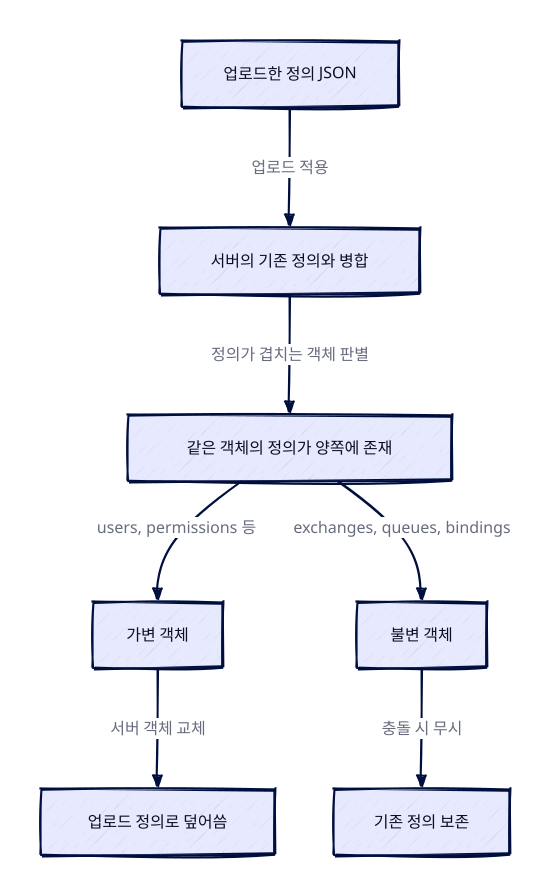

> 🤖 이 글은 공식문서를 근거로 **AI가 자동 생성**한 학습 노트입니다.

> 한 줄 요약: RabbitMQ HTTP API는 HTTP basic authentication과 `application/json`만을 사용하는 관리 REST API로, 리소스 생성·조회부터 클러스터 정의(definition) 내보내기·가져오기까지 모든 관리 기능을 일반 HTTP 클라이언트로 수행할 수 있게 한다.

### 개요

RabbitMQ HTTP API는 RabbitMQ의 관리 기능을 HTTP로 사용할 수 있게 하는 인터페이스다. 이 API는 `curl` 같은 일반 HTTP 클라이언트로도 호출할 수 있고, Team RabbitMQ가 개발한 `rabbitmqadmin` v2 CLI 도구나 여러 성숙한 HTTP API 클라이언트 라이브러리를 통해서도 쓸 수 있다.

동작 규약 자체는 단순하다. 모든 엔드포인트는 `application/json` 타입의 리소스만 서빙하고, RabbitMQ 표준 사용자 데이터베이스에 대한 HTTP basic authentication을 요구한다. 기본 사용자 계정은 `guest/guest`다. 리소스 생성·수정·삭제도 HTTP 메서드와 JSON 본문으로 표현되므로, HTTP 클라이언트만 있으면 AMQP 프로토콜을 직접 다루지 않고도 브로커를 관리할 수 있다.

### HTTP API의 기본 규칙

#### 가상 호스트 이름 인코딩

이름은 가상 호스트 범위 안에서만 객체를 유일하게 식별하므로, 많은 URI는 경로의 일부로 가상 호스트 이름을 요구한다. 기본 가상 호스트의 이름이 `/`이기 때문에 경로에서는 `%2F`로 인코딩해야 한다. 예를 들어 기본 가상 호스트의 정의를 조회하는 요청은 `GET /api/definitions/%2F`가 된다.

#### PUT으로 리소스 생성하기

`PUT`은 리소스를 생성한다. 업로드하는 JSON 객체는 엔드포인트마다 문서화된 필수 키(mandatory keys)를 가져야 하며, 선택 키를 추가할 수도 있다. 문서에 없는 다른 키는 무시되고, 필수 키가 빠지면 오류로 처리된다.

#### 바인딩의 합성 이름과 팩토리 URI

AMQP에서 바인딩은 이름이나 ID가 없으므로 HTTP API는 바인딩의 모든 속성을 바탕으로 이름을 합성(synthesise)한다. 하지만 이 합성 이름은 일반적인 경우 예측하기 어렵기 때문에, 팩토리 URI에 `POST`를 보내는 방식으로도 바인딩을 생성할 수 있다.

#### 리스트 조회와 성능 제어

리스트를 반환하는 URI에는 공통 쿼리 파라미터를 쓸 수 있다. `sort`는 정렬할 기본 필드를 고르고, `sort_reverse=true`는 정렬 순서를 뒤집는다. `sort`는 점으로 구분된 하위 필드(subfields)도 지원하므로 중첩 구성 요소 기준으로 정렬할 수 있지만, 여러 필드를 동시에 정렬 기준으로 삼을 수는 없다. `columns` 파라미터를 쓰면 항목당 반환되는 정보를 점으로 구분된 하위 필드의 쉼표 구분 목록으로 제한할 수 있다.

또한 통계가 필요 없는 모니터링·운영 쿼리를 위해 `disable_stats=true`를 지정할 수 있다. 이 경우 GET 요청에서 통계가 빠지고 각 객체의 기본 정보만 반환되는데, 반환 데이터 양과 쿼리당 메모리·리소스 소모가 크게 줄어든다.

### 정의(Definitions) 내보내기와 가져오기

#### 클러스터 전체 정의

`GET /api/definitions`는 클러스터 전체 정의를 내보낸다. 여기에는 모든 exchange, queue, binding, 사용자, 가상 호스트, 권한, 토픽 권한, 파라미터가 포함되며 메시지는 포함되지 않는다. 반대로 `POST /api/definitions`는 기존 정의 집합을 업로드해 가져온다.

가져오기는 단순 대체가 아니라 병합(merge)으로 동작한다. 업로드한 정의에 없는 기존 객체는 건드리지 않으며, 충돌이 발생하면 객체의 성격에 따라 처리 방식이 갈린다. exchange, queue, binding 같은 불변(immutable) 객체의 충돌은 무시되고 기존 정의가 보존되지만, 가변(mutable) 객체의 충돌은 서버의 객체가 업로드된 정의로 덮어써진다. 가져오기 도중 오류가 나면 정의가 부분 적용된 상태로 남는다.

이 엔드포인트는 `application/json` 외에 `multipart/form-data`도 지원하며, 이 경우 정의 파일은 `file`이라는 이름의 폼 필드로 업로드한다.

#### 가상 호스트별 정의

`GET /api/definitions/{vhost}`는 단일 가상 호스트의 정의를 내보낸다. 가상 호스트별 정의에는 가상 호스트 이름에 대한 정보가 들어 있지 않으므로, 원래 가상 호스트 이름과 대상 가상 호스트 이름이 일치하지 않아도 아무 가상 호스트로 가져올 수 있다.

`POST /api/definitions/{vhost}`는 단일 가상 호스트의 exchange, queue, binding, 사용자, 권한, 토픽 권한, 파라미터를 가져온다. 이 엔드포인트에서는 반대로 클러스터 전체 정의를 가져올 수 없다. 병합·충돌 처리·오류 시 부분 적용 등의 규칙은 클러스터 전체 정의 엔드포인트와 동일하며, `multipart/form-data` 업로드도 같은 방식으로 지원된다.


<figure class="ai-scene"><figcaption>정의 가져오기 병합: 불변·가변 객체 충돌 처리 비교 · 설명용 시각화</figcaption><iframe class="ai-scene-frame" src="/assets/generated/designs/2026-11-02-rabbitmq-http-api-json-기반-관리-인터페이스의-동작-원리-e018ec3ad53625db-1.html" title="정의 가져오기 병합: 불변·가변 객체 충돌 처리 비교" sandbox="allow-scripts" referrerpolicy="no-referrer" loading="lazy" height="560"></iframe>
POST /api/definitions는 병합으로 동작한다. 같은 객체가 양쪽에 있으면 불변 객체(queue·exchange·binding)는 기존 정의를 보존하고, 가변 객체(user 등)는 업로드 정의로 덮어쓴다. queue·user 값은 설명용 예시다.
</figure>


### 주요 상태 조회 엔드포인트

시스템 전반의 상태를 조회하는 엔드포인트는 다음과 같다.

- `GET /api/overview`: 시스템 전체를 설명하는 여러 정보를 반환한다.
- `GET /api/cluster-name`과 `PUT /api/cluster-name`: 클러스터를 식별하는 이름을 조회하거나 변경한다.
- `GET /api/nodes`와 `GET /api/nodes/{name}`: 클러스터의 모든 노드 또는 개별 노드의 메트릭을 반환한다.
- `GET /api/nodes/{name}/memory`: 특정 노드의 메모리 사용 내역(breakdown)을 반환한다.
- `GET /api/feature-flags`: 모든 feature flag와 그 상태를 나열한다.
- `GET /api/deprecated-features`와 `GET /api/deprecated-features/used`: 모든 폐기 기능의 상태, 또는 이 클러스터에서 실제 사용 중인 폐기 기능을 나열한다.

문서의 호출 예시는 기본 포트 `15672`의 `/api/...` 경로를 `curl`로 호출하는 형태다. `curl -sL -u guest:guest -H "Accept: application/json" http://127.0.0.1:15672/api/overview`처럼 쓰며, `jq`는 출력을 보기 좋게 만드는 선택 도구일 뿐 필수는 아니다.

### 연결(Connection) 관리

`GET /api/connections`는 열려 있는 모든 연결의 목록을 반환한다. 이 엔드포인트는 응답이 매우 커질 수 있고 대역폭과 CPU 자원을 낭비할 수 있으므로, 목록 조회에는 페이징 파라미터를 사용하라고 문서는 권장한다. 기본 페이지 크기는 100이고 최대 지원 크기는 500이다. 특정 가상 호스트의 연결만 보려면 `GET /api/vhosts/{vhost}/connections`를 쓰며, 이 엔드포인트도 같은 페이징 규칙을 따른다.

개별 연결은 `GET /api/connections/{name}`으로 조회하는데, 연결 이름이 경로에 들어가므로 반드시 퍼센트 인코딩해야 한다. `DELETE /api/connections/{name}`은 연결을 닫으며, 필요하면 `X-Reason` 헤더로 사유를 함께 남길 수 있다. 특정 사용자 이름으로 인증한 연결만 보려면 `GET /api/connections/username/{username}`을 사용한다. 단일 연결 정보를 얻으려고 전체 목록을 호출하는 것은 불필요한 부하를 만드는 실수이므로, 문서도 이런 호출을 경계하라고 주의를 달아 두었다.

### 폐기된 엔드포인트 주의

`GET /api/aliveness-test`는 `rabbitmqctl node_health_check`에 대응하는 HTTP API 버전으로, 오랫동안 폐기된 침습적이고 관점이 강한(intrusive, opinionated) 헬스 체크였다. 이 엔드포인트는 2021년부터 폐기되었고 RabbitMQ `4.0`부터 no-op이었으며, `4.1.0`부터는 완전히 no-op으로 동작한다. 폐기된 엔드포인트는 언젠가 아무 동작도 하지 않게 되거나 완전히 제거될 수 있으므로, 이에 의존하지 말아야 한다.

### 정리

RabbitMQ HTTP API는 JSON 응답과 HTTP basic authentication을 기본 규약으로 하는 관리 REST API다. 리소스는 `PUT`으로 생성하고, 경로에 들어가는 기본 가상 호스트 `/`는 `%2F`로 인코딩하며, 리스트 조회에는 `sort`, `sort_reverse`, `columns`, `disable_stats` 같은 공통 파라미터가 적용된다.

정의 내보내기와 가져오기는 클러스터 전체와 가상 호스트별 형식으로 나뉘고, 가져오기는 병합 방식으로 동작한다. 불변 객체의 충돌은 기존 정의를 보존하고 가변 객체의 충돌만 업로드한 정의로 덮어쓴다. 연결 목록 조회는 페이징이 필요하며, no-op이 된 `aliveness-test` 같은 폐기 엔드포인트는 사용하지 않는 것이 안전하다.

---
> 🤖 작성 모델: `deepseek/deepseek-v4-flash-0731` (OpenRouter)
> 
> 참고한 공식문서:
> - [https://www.rabbitmq.com/docs/http-api-reference](https://www.rabbitmq.com/docs/http-api-reference)
> - [https://www.rabbitmq.com/client-libraries/devtools](https://www.rabbitmq.com/client-libraries/devtools)
