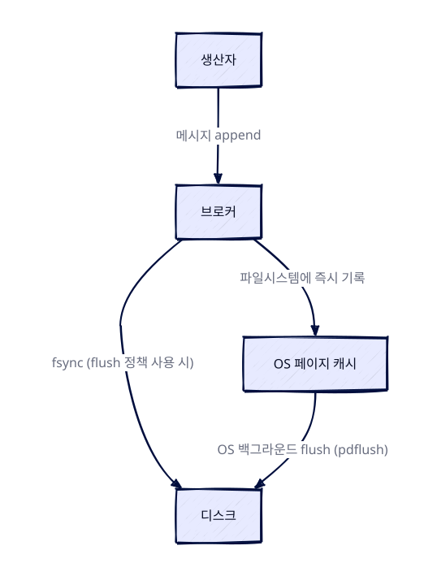

> 🤖 이 글은 공식문서를 근거로 **AI가 자동 생성**한 학습 노트입니다.

> 한 줄 요약: Kafka는 데이터를 OS 페이지 캐시에 즉시 기록하므로 메모리·디스크 산정과 커널 설정이 성능을 좌우한다. flush 기본값, XFS·EXT4 선택, KRaft 컨트롤러 디스크 교체 순서까지 운영 원리를 정리한다.

### 개요

Kafka 브로커는 받은 데이터를 프로세스 내부 캐시에 쌓아 두지 않고 즉시 파일시스템에 기록한다. 그래서 Kafka의 실제 데이터 경로는 OS의 페이지 캐시와 디스크를 통과하며, 하드웨어 사양과 OS 설정, 파일시스템 선택이 처리량·지연 시간·장애 복구 특성을 좌우한다. 이 글은 공식 문서의 Hardware and OS 항목을 바탕으로 메모리·디스크 산정 기준, 세 가지 OS 튜닝 포인트, flush 메커니즘, 파일시스템 선택, KRaft 컨트롤러 디스크 교체 시 주의점을 정리한다.

### 하드웨어: 메모리와 디스크 산정 기준

공식 문서는 참고 환경으로 듀얼 쿼드코어 Intel Xeon 머신에 24GB 메모리를 사용한다고 밝힌다. 메모리는 활성 상태의 읽기·쓰기 클라이언트를 버퍼링할 수 있을 만큼 필요하며, 대략적인 산정은 30초간 버퍼링한다고 가정해 `write_throughput * 30`으로 계산한다.

디스크 처리량은 Kafka 성능의 주요 병목이며 일반적으로 디스크가 많을수록 좋다. 문서의 참고 환경은 8개의 7200rpm SATA 드라이브를 사용한다. flush를 자주 강제하는 구성이라면 고RPM SAS 드라이브가 더 유리할 수 있으므로, 디스크 선택은 flush 동작 방식과 함께 결정해야 한다.

### OS 튜닝: 파일 디스크립터, 소켓 버퍼, 메모리 맵 영역

Kafka는 유닉스 계열 OS에서 잘 동작하며 Linux와 Solaris에서 테스트되었다. Windows에서는 몇 가지 문제가 관찰되어 현재는 잘 지원되지 않는 플랫폼이다. Kafka는 OS 레벨 튜닝을 많이 요구하지는 않지만, 잠재적으로 중요한 설정 세 가지가 있다.

#### 파일 디스크립터 한도

Kafka는 로그 세그먼트와 열린 연결에 파일 디스크립터를 사용한다. 브로커가 많은 파티션을 호스팅한다면 로그 세그먼트 추적에 최소한 `파티션 수 * (파티션 크기 / 세그먼트 크기)`만큼의 디스크립터가 필요하고, 여기에 연결 수가 더해진다. 문서는 브로커 프로세스의 시작점으로 최소 100000개의 파일 디스크립터를 권장한다.

한편 `mmap()`은 파일 디스크립터에 추가 참조를 남기며, 이 참조는 해당 파일에 대한 매핑이 모두 사라져야 제거된다. 따라서 `close()`를 호출했다고 해서 디스크립터가 바로 해제되지는 않는다.

#### 최대 소켓 버퍼 크기

데이터센터 간 고성능 데이터 전송이 필요하다면 최대 소켓 버퍼 크기를 늘릴 수 있다.

#### vm.max_map_count

이 값은 브로커가 가질 수 있는 최대 파티션 수와 관련된 OS 속성이다. 많은 Linux 시스템의 기본값은 65535 정도다. 로그 세그먼트 하나는 index/timeindex 파일 쌍을 가지며, 각 파일이 메모리 맵 영역 1개를 소비하므로 로그 세그먼트당 2개의 맵 영역이 필요하다. 따라서 파티션 하나는 로그 세그먼트를 하나만 가져도 최소 2개의 맵 영역을 차지한다.

예를 들어 브로커에 50000개의 파티션을 만들면 100000개의 맵 영역이 할당되어, 기본 `vm.max_map_count`에서는 `OutOfMemoryError (Map failed)`로 브로커가 죽을 가능성이 높다. 게다가 파티션당 로그 세그먼트 수는 세그먼트 크기, 부하 강도, 보존 정책에 따라 달라지며 대개 1개보다 많다.



<figure class="ai-scene"><figcaption>같은 OS 한도에서 파티션 수가 생존을 가른다 · 설명용 시각화</figcaption><iframe class="ai-scene-frame" src="/assets/generated/designs/2026-11-04-kafka-하드웨어와-os-메모리-디스크-산정-flush와-파일시스템의-운영-원리-c47bcacec40eb094-1.html" title="같은 OS 한도에서 파티션 수가 생존을 가른다" sandbox="allow-scripts" referrerpolicy="no-referrer" loading="lazy" height="560"></iframe><p class="ai-scene-summary">파티션당 최소 2개 맵 영역(단일 로그 세그먼트)으로 계산한 설명용 수치다. 30000 파티션은 비교용 예시이고, 50000 파티션의 100000 맵 영역과 크래시 가능성은 문서 사례다.</p></figure>


### 디스크 구성과 데이터 내구성의 원리

디스크 구성과 내구성 정책은 서로 영향을 주는 두 가지 선택으로 나뉜다. 하나는 데이터 디렉터리를 RAID로 묶을지 별도로 둘지이고, 다른 하나는 데이터가 디스크로 내려가는 시점을 OS에 맡길지 애플리케이션이 제어할지다.

#### RAID와 다중 데이터 디렉터리

좋은 처리량을 얻으려면 여러 드라이브를 사용하고, Kafka 데이터용 드라이브를 애플리케이션 로그나 다른 OS 파일시스템 활동과 공유하지 않는 것이 권장된다. 드라이브는 RAID로 묶어 단일 볼륨으로 쓰거나, 각 드라이브를 별도 디렉터리로 포맷·마운트할 수 있다. Kafka가 복제를 제공하므로 RAID가 주는 중복성은 애플리케이션 레벨에서도 확보할 수 있으며, 두 구성은 서로 다른 트레이드오프를 가진다.

여러 데이터 디렉터리를 쓰면 파티션이 라운드로빈으로 디렉터리에 배정되고, 각 파티션은 하나의 디렉터리에 통째로 저장된다. 파티션 간 데이터가 균형 잡히지 않으면 디스크 간 부하 불균형이 생긴다. RAID는 더 낮은 레벨에서 부하를 분산하므로 디스크 간 부하 균형에 유리할 수 있지만(항상 그런 것은 아니다), 쓰기 처리량에 큰 타격을 주고 사용 가능한 디스크 공간을 줄이는 단점이 있다.

RAID는 디스크 장애를 견디는 이점도 있지만, 문서의 경험상 RAID 배열 재구축이 매우 I/O 집약적이어서 사실상 서버를 사용할 수 없게 만든다. 그래서 실제 가용성 개선 효과는 크지 않다고 본다.

#### 애플리케이션 fsync와 OS 페이지 캐시

Kafka는 모든 데이터를 즉시 파일시스템에 기록하며, 데이터가 OS 캐시에서 디스크로 강제 내려가는 시점을 제어하는 flush 정책을 설정할 수 있다. 이 정책은 일정 시간이 지난 후 또는 일정 개수의 메시지가 쓰인 후 데이터를 디스크로 강제 기록하도록 구성한다.

Kafka가 데이터가 실제로 flush되었음을 알려면 결국 `fsync`를 호출해야 한다. 크래시 복구 시 fsync가 완료된 것으로 알려지지 않은 로그 세그먼트는 시작 과정에서 각 메시지의 CRC를 검사하고 오프셋 인덱스 파일을 재구성한다. 단, Kafka의 내구성은 디스크 동기화를 요구하지 않는다. **내구성은 복제가 보장**하며, 실패한 노드는 항상 복제본에서 복구되기 때문이다.

문서는 애플리케이션 fsync를 완전히 비활성화하는 기본 flush 설정을 권장한다. 기본 설정은 OS의 백그라운드 flush와 Kafka 자체의 백그라운드 flush에 의존하며, 튜닝할 설정 없이 처리량·지연 시간·복구 보장을 모두 얻을 수 있다. 문서의 판단은 복제가 제공하는 보장이 로컬 디스크 동기화보다 강력하다는 것이며, 그래도 둘 다 원하는 경우를 위해 애플리케이션 레벨 fsync 정책도 여전히 지원된다.

애플리케이션 레벨 flush의 단점은 OS가 쓰기 순서를 재배열할 여지가 줄어 디스크 사용 패턴의 효율이 낮아진다는 점이다. 또한 대부분의 Linux 파일시스템에서 fsync는 파일에 대한 쓰기를 블록하므로 지연 시간이 발생할 수 있는 반면, 백그라운드 flush는 훨씬 세밀한 페이지 레벨 잠금을 사용한다.



Linux에서 파일시스템에 쓴 데이터는 애플리케이션의 fsync나 OS의 flush 정책에 의해 디스크로 내려갈 때까지 페이지 캐시에 유지된다. 이 flush 작업은 pdflush(2.6.32 이후 커널에서는 flusher 스레드)라는 백그라운드 스레드들이 수행하며, 캐시에 유지할 dirty 데이터의 양과 기간을 정책으로 설정할 수 있다. pdflush가 쓰기 속도를 따라가지 못하면 결국 쓰기 프로세스가 블록되어 지연이 발생한다. 현재 OS 메모리 상태는 `cat /proc/meminfo`로 확인할 수 있다.

페이지 캐시는 프로세스 내부 캐시를 쓰는 것보다 몇 가지 이점이 있다. I/O 스케줄러가 연속된 작은 쓰기를 더 큰 물리적 쓰기로 배치하고, 디스크 헤드 이동을 최소화하도록 쓰기 순서를 재배열해 처리량을 높인다. 또한 머신의 모든 여유 메모리를 자동으로 사용한다.

### 파일시스템 선택: XFS와 EXT4

Kafka는 디스크에 일반 파일을 사용하므로 특정 파일시스템에 대한 하드 의존성은 없다. 다만 실제 사용이 가장 많은 파일시스템은 EXT4와 XFS다. 역사적으로는 EXT4의 사용이 많았지만, XFS는 최근 개선으로 Kafka 워크로드에서 안정성 저하 없이 더 나은 성능 특성을 보여준다.

문서의 비교 테스트는 상당한 메시지 부하가 있는 클러스터에서 다양한 파일시스템 생성·마운트 옵션을 사용하며, append 작업 시간을 나타내는 "Request Local Time" 지표를 관찰했다. XFS는 최상의 EXT4 구성(250ms 이상)보다 훨씬 좋은 160ms 수준의 로컬 시간과 더 낮은 평균 대기 시간을 기록했고, 디스크 성능 변동도 더 적었다.

두 파일시스템의 차이를 요약하면 다음과 같다.

| 비교 항목 | XFS | EXT4 |
|---|---|---|
| 기본 튜닝 | 자동 튜닝이 많아 생성·마운트 시 기본값 유지 | 성능을 얻으려면 여러 마운트 옵션 조정 필요 |
| Request Local Time | 약 160ms | 최적 구성에서도 250ms 이상 |
| 성능 변동 | 변동이 더 적음 | XFS보다 변동이 큼 |
| 안정성 | 성능 개선에도 안정성 저하 없음 | 성능 옵션들이 장애 시 데이터 손상 위험 수반 |

어느 파일시스템이든 Linux에서 데이터 디렉터리에 사용할 때는 마운트 시 `noatime` 옵션이 권장된다. 이 옵션은 파일을 읽을 때 atime(마지막 접근 시간) 갱신을 비활성화한다. Kafka는 atime에 전혀 의존하지 않으므로 안전하게 비활성화할 수 있고, 특히 컨슈머 부트스트래핑 상황에서 파일시스템 쓰기 횟수를 크게 줄여준다.

#### XFS 튜닝

XFS는 자동 튜닝이 많아 생성 시나 마운트 시 기본 설정을 바꿀 필요가 없다. 고려할 만한 옵션은 `largeio`와 `nobarrier` 두 가지뿐이다. `largeio`는 `stat` 호출이 보고하는 선호 I/O 크기에 영향을 주지만, 실제로는 성능에 최소 또는 무효과였다. `nobarrier`는 배터리 백업 캐시가 있는 디바이스에서 주기적인 쓰기 flush를 비활성화해 약간의 성능을 얻을 수 있다. 다만 잘 동작하는 디바이스는 파일시스템에 flush가 필요 없다고 보고하므로, 이 경우 옵션은 효과가 없다.

#### EXT4 튜닝

EXT4는 Kafka 데이터 디렉터리로 쓸 수 있는 선택지이지만, 최고 성능을 끌어내려면 여러 마운트 옵션을 조정해야 한다. 문제는 이 옵션들이 장애 상황에서 일반적으로 안전하지 않아 더 많은 데이터 손실과 손상을 초래한다는 점이다. 단일 브로커 장애라면 디스크를 밀어 버리고 클러스터에서 복제본을 재구축하면 되지만, 정전 같은 다중 장애 상황에서는 파일시스템(따라서 데이터) 손상이 쉽게 복구되지 않을 수 있다.

조정 가능한 옵션은 다음과 같다.

- `data=writeback`: EXT4 기본값인 `data=ordered`는 일부 쓰기에 강한 순서를 부과한다. Kafka는 flush되지 않은 모든 로그에 대해 매우 철저한 데이터 복구를 수행하므로 이 순서가 필요 없다. 순서 제약을 제거하면 지연 시간이 크게 줄어든다.
- 저널링 비활성화: 저널링은 서버 크래시 후 재부팅을 빠르게 해 주는 대신 많은 추가 잠금을 도입해 쓰기 성능의 변동을 키운다. 재부팅 시간을 신경 쓰지 않는다면 쓰기 지연 스파이크의 주요 원인을 없애기 위해 저널링을 완전히 끌 수 있다.
- `commit=num_secs`: EXT4가 메타데이터 저널에 커밋하는 빈도를 조정한다. 값을 낮추면 크래시 시 flush되지 않은 데이터의 손실이 줄고, 높이면 처리량이 좋아진다.
- `nobh`: `data=writeback` 모드에서 추가 순서 보장을 제어한다. Kafka는 쓰기 순서에 의존하지 않으므로 안전하며 처리량과 지연 시간을 개선한다.
- `delalloc`: 지연 할당으로, 물리적 쓰기가 발생할 때까지 블록 할당을 미룬다. EXT4가 작은 페이지 대신 큰 extent를 할당하고 데이터를 순차적으로 쓰게 도와 처리량에 큰 도움이 된다. 다만 파일시스템의 잠금이 약간의 지연 시간 변동을 추가하는 것으로 보인다.
- `fast_commit`: Linux 5.10에서 추가된 경량 저널링 방식으로 `data=ordered` 모드와 함께 쓸 수 있으며, 지연 시간을 크게 줄여주는 것으로 보인다.

### KRaft 컨트롤러 디스크 교체

KRaft 모드에서 컨트롤러는 `metadata.log.dir`에 지정된 디렉터리에 클러스터 메타데이터를 저장하며, 이 설정이 없으면 첫 번째 로그 디렉터리를 사용한다. 하드웨어 장애로 메타데이터 디렉터리의 데이터가 유실되거나 디스크를 교체해야 한다면 새 컨트롤러 노드의 프로비저닝에 주의가 필요하다.

이때의 원칙은 하나다. **과반수의 컨트롤러가 커밋된 데이터를 모두 가질 때까지 새 노드를 포맷하거나 시작하지 않는다.** 복제 상태는 `kafka-metadata-quorum.sh` 도구로 확인한다.

```bash
$ bin/kafka-metadata-quorum.sh --bootstrap-server localhost:9092 describe --replication
```

이 명령은 각 노드의 `LogEndOffset`, `Lag`, `LastFetchTimestamp`, `LastCaughtUpTimestamp`를 보여준다. 과반수 컨트롤러의 `Lag`가 작아질 때까지 기다린다. 리더의 end offset이 증가하지 않는 상황이라면 과반수의 lag가 0이 될 때까지 기다리고, 증가하는 상황이라면 최신 리더의 end offset을 기준으로 모든 복제본이 그 지점에 도달할 때까지 기다린다. 또한 과반수 컨트롤러의 `LastFetchTimestamp`와 `LastCaughtUpTimestamp`가 서로 가까워졌는지 확인해야 한다. 이 조건들이 충족된 뒤에야 메타데이터 로그 디렉터리 포맷이 안전하다.

포맷은 `kafka-storage.sh`로 수행한다.

```bash
$ bin/kafka-storage.sh format --cluster-id uuid --config config/server.properties
```

이 명령은 `Log directory ... is already formatted` 메시지로 실패할 수 있다. 결합 모드에서 메타데이터 로그 디렉터리만 유실되고 다른 디렉터리들은 유지된 경우에 이런 일이 발생하며, 이 경우에만 `--ignore-formatted` 옵션을 사용할 수 있다. 포맷 후에는 `kafka-server-start.sh`로 컨트롤러를 시작한다.

### 정리

Kafka의 하드웨어·OS 운영은 결국 OS 페이지 캐시를 얼마나 잘 활용하는가로 귀결된다. 메모리는 30초 버퍼링을 가정해 `write_throughput * 30`으로 산정하고, 디스크 처리량이 병목이므로 여러 드라이브를 쓰되 RAID의 쓰기 손실과 재구축 부담을 함께 고려해야 한다. OS 레벨에서는 파일 디스크립터와 `vm.max_map_count`가 파티션 확장의 실제 제약이며, 로그 세그먼트당 2개의 맵 영역이 필요하다는 점을 설계에 반영해야 한다. 내구성은 디스크 동기화가 아니라 복제가 보장하며, 기본 flush 설정이 OS 백그라운드 flush에 의존하는 이유가 여기에 있다. 파일시스템은 XFS가 Kafka 워크로드에 유리하고, KRaft 컨트롤러 디스크 교체는 과반 컨트롤러가 커밋된 메타데이터를 따라잡은 뒤에만 진행해야 한다.

---
> 🤖 작성 모델: `deepseek/deepseek-v4-flash-0731` (OpenRouter)
> 
> 참고한 공식문서:
> - [https://kafka.apache.org/documentation/](https://kafka.apache.org/documentation/)
