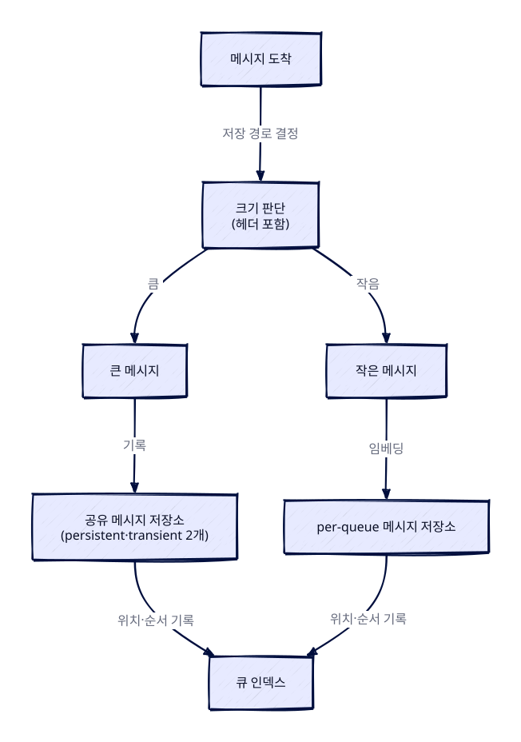

> 🤖 이 글은 공식문서를 근거로 **AI가 자동 생성**한 학습 노트입니다.

> 한 줄 요약: Classic Queues는 RabbitMQ의 기본 큐 타입으로, 메시지를 복제하지 않는 FIFO 큐다. 큐 인덱스가 메시지 위치를 추적하고, 메시지 크기와 소비 속도에 따라 per-queue 저장소·공유 저장소·메모리 사용을 조절한다.

### 개요
Classic queue는 RabbitMQ의 원조 큐 타입(original queue type)이다. 비복제(non-replicated) FIFO 큐 구현을 사용하므로 큐에 저장된 데이터는 복제되지 않으며, 데이터 안전성이 최우선인 사용처에는 적합하지 않다. 데이터 안전성이 중요하다면 RabbitMQ 문서는 quorum queues와 streams를 권장한다.

Classic queue는 가상 호스트(vhost)에서 기본 큐 타입을 재정의하지 않는 한 RabbitMQ의 기본 큐 타입이다. RabbitMQ 4.0부터 classic queue는 비복제 큐 타입이 되었으며, 고가용성과 데이터 안전성이 필요할 때는 quorum queues와 streams가 더 나은 대안이다.

### Classic Queue의 특징과 한계
Classic queue는 큐 독점(queue exclusivity), 큐·메시지 TTL, 큐 길이 제한, 메시지 우선순위, 소비자 우선순위를 완전히 지원하고, 정책(policy)으로 제어되는 설정을 따른다.

데드 레터 교환(dead letter exchange)도 지원하지만, quorum queue가 지원하는 at-least-once dead-lettering은 지원하지 않는다. 또한 quorum queue와 달리 poison message 처리를 지원하지 않는다.

RabbitMQ 4.3부터 두 가지 기본값이 바뀐다. 전역 QoS prefetch(global QoS prefetch)는 deprecated이고 기본적으로 비활성화되므로 per-consumer QoS prefetch를 사용해야 한다. durable하지도 exclusive하지도 않은 classic queue도 deprecated이고 기본적으로 비활성화되므로, durable queue나 exclusive queue를 사용해야 한다.

### 저장 구조: 큐 인덱스와 메시지 저장소
Classic queue는 메시지의 디스크 위치를 기록하는 온디스크 인덱스(on-disk index)와 메시지를 영속화하는 메시지 저장소(message store)로 구성된다. 각 큐는 인덱스를 하나씩 가지며, 큐는 메시지의 위치와 큐 안에서의 순서(position)를 추적해 이 정보를 인덱스에 영속화한다.

영속화된 메시지는 큐에 임베딩(embedding)되거나 공유 메시지 저장소(shared message store)로 보내진다. 어느 쪽에 저장할지는 헤더를 포함한 메시지 크기로 결정한다. 작은 메시지는 per-queue 메시지 저장소에 기록되고, 큰 메시지는 공유 메시지 저장소에 기록된다. 공유 메시지 저장소는 큰 메시지, 특히 여러 큐로 보내지는 메시지를 처리할 때 더 효율적이다.

공유 메시지 저장소는 vhost마다 두 개가 있다. 하나는 persistent 메시지용이고 다른 하나는 transient 메시지용이며, 보통 합쳐서 공유 메시지 저장소라고 부른다. vhost의 모든 큐는 같은 메시지 저장소를 사용한다.

RabbitMQ 4.4부터 새 공유 저장소 파일은 `.sqs` 포맷을 사용한다. 기존 `.rdq` 파일은 계속 읽을 수 있고 자동으로 다시 쓰이지 않는다. `.sqs` 파일이 있는 노드는 RabbitMQ 4.3 이하로 다운그레이드할 수 없다.


<figure class="ai-scene"><figcaption>메시지 크기가 저장 위치를 어떻게 결정하는가? · 설명용 시각화</figcaption><iframe class="ai-scene-frame" src="/assets/generated/designs/2026-11-06-rabbitmq-classic-queues-비복제-fifo-큐의-저장-구조와-동작-원리-da4c29e8cd586a1d-1.html" title="메시지 크기가 저장 위치를 어떻게 결정하는가?" sandbox="allow-scripts" referrerpolicy="no-referrer" loading="lazy" height="560"></iframe>
설명용 메시지 크기(2KB·8KB)로 비교한다. 영속화된 메시지 기준, 헤더 포함 크기가 기본 임베딩 임계값 4096B보다 작으면 per-queue 저장소, 크면 공유 저장소에 기록된다. 큐 인덱스는 어느 쪽이든 위치를 기록한다.
</figure>


### 디스크 기록과 메모리 유지 조건
Classic queue는 persistent 메시지든 transient 메시지든 항상 디스크에 기록한다. 단, 다음 세 가지 경우는 예외다.

- 큐가 transient로 선언되었거나 메시지가 transient인 경우
- 메시지가 임베딩 임계값(기본 4096바이트)보다 작은 경우
- 큐가 짧은 경우(소비자 전달 속도에 따라 최대 2048개 메시지를 메모리에 유지)

일반적으로 메시지는 소비율이 충분히 높아 메모리에 있는 메시지가 다음 1초 안에 소비될 것으로 예상될 때만 메모리에 유지된다. Classic queue는 소비자 전달 속도에 따라 최대 2048개 메시지를 메모리에 유지하며, 큰 메시지는 소비자에게 보내야 하는 순간까지 디스크에서 읽지 않는다. RabbitMQ 3.12에서는 임베딩 임계값(기본 4096바이트)보다 큰 메시지가 여기에 해당한다.

### 스토리지 구현 버전 2와 리소스 사용
Classic queue는 별도 설정 없이도 대부분의 상황에서 합리적으로 좋은 처리량을 제공하는 것을 목표로 한다. 다만 안정성, 처리량, 지연 시간, I/O 특성에 영향을 주는 일부 설정값은 때때로 유용하다.

Classic queue는 버전 2 스토리지 구현을 사용하며, 버전 1은 RabbitMQ 4.0부터 더 이상 지원되지 않는다. 버전 2는 인덱스에 세그먼트 파일만 사용하고 필요할 때만 디스크에서 메시지를 로드한다. 현재 소비율에 따라 더 많은 메시지를 로드하며, 인덱스에 메시지를 임베딩하지 않고 per-queue 메시지 저장소를 사용한다. 버전 2는 RabbitMQ 3.10.0에서 추가되었고 3.12.0에서 크게 개선되었다.

#### 파일 핸들 사용
RabbitMQ 서버는 열 수 있는 파일 핸들 수에 제한이 있다. 실행 중인 네트워크 연결마다 파일 핸들 하나가 필요하고, 나머지가 큐가 사용할 수 있다. 버전 2는 버전 1처럼 낮은 파일 디스크립터 수에 맞추려 하지 않으며, 서버에 큰 파일 디스크립터 한도가 설정되어 있다고 가정한다.

인덱스는 항상 최대 4개의 파일 핸들을 열어 두고, per-queue 저장소는 1개를 유지하되 디스크로 플러시할 때 1개를 더 열 수 있다. 이론상 큐 하나가 제대로 동작하려면 최대 6개의 파일 디스크립터가 필요하다. 실제로는 바쁜 큐만 그만큼 필요하고, 다른 큐는 3~4개로도 잘 동작한다. 파일 핸들 관리 하위 시스템을 사용하지 않기 때문에 버전 2는 I/O 통계를 많이 추적하지 않으며, 읽기와 쓰기의 횟수만 제공한다. 그 외 지표는 OS 레벨에서 얻어야 한다.

#### 메모리 사용
버전 2의 인덱스와 per-queue 저장소는 항목을 버퍼링한다. 인덱스는 메타데이터만 추적하므로 보통 문제가 되지 않지만, per-queue 저장소는 기본적으로 최대 1MB 메모리를 사용한다(쓰기 버퍼 512KB + 캐시 512KB). 디스크로 플러시할 때 저장소는 먼저 캐시를 비운 다음 쓰기 버퍼의 메시지를 캐시로 옮겨, 캐시의 데이터를 쓰기 버퍼의 데이터로 교체한다. 쓰기 버퍼와 캐시 크기는 서로 연결되어 있으며, rabbit의 `classic_queue_store_v2_max_cache_size` 고급 설정으로 구성할 수 있다.

유휴 큐는 메모리 사용을 줄인다. 이 때문에 새 정책 정의처럼 많은 큐에 영향을 주는 작업을 수행하면 큐들이 다시 메모리를 할당하면서 예상치 못한 메모리 스파이크가 발생할 수 있다. 큐가 많을수록 스파이크도 커진다.

공유 메시지 저장소는 인덱스가 필요하다. 기본 메시지 저장소 인덱스는 저장소 안의 메시지마다 약간의 메모리를 사용한다. 메시지 저장소 인덱스는 플러그인으로 교체할 수 있으며, 이 메모리 제약을 없애는 구현도 플러그인으로 존재한다. 다만 이런 플러그인은 모두 네이티브 코드를 사용하기 때문에 RabbitMQ 배포판에 포함되지 않았고, 일반적으로 메시지 저장소를 더 느리게 만든다.

### 정리
Classic queue는 RabbitMQ의 기본 큐 타입이자 비복제 FIFO 큐로, 데이터 안전성보다 처리량과 단순함이 우선인 상황에 적합하다. 저장 구조는 큐 인덱스와 per-queue·공유 메시지 저장소로 나뉘며, 메시지 크기와 소비 속도에 따라 디스크·메모리 사용이 결정된다. 데이터 안전성이나 고가용성이 중요하다면 quorum queues나 streams를 선택해야 한다.

---
> 🤖 작성 모델: `deepseek/deepseek-v4-flash-0731` (OpenRouter)
> 
> 참고한 공식문서:
> - [https://www.rabbitmq.com/docs/classic-queues](https://www.rabbitmq.com/docs/classic-queues)
