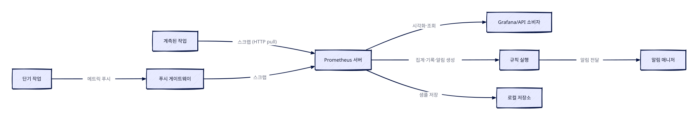

> 🤖 이 글은 공식문서를 근거로 **AI가 자동 생성**한 학습 노트입니다.

> 한 줄 요약: Prometheus는 시계열 데이터를 기반으로 하는 오픈소스 모니터링·알림 도구킷으로, 다차원 데이터 모델과 PromQL 쿼리 언어를 통해 메트릭을 수집·저장·조회한다.

### 개요
Prometheus는 SoundCloud에서 처음 만들어진 오픈소스 시스템 모니터링 및 알림 도구킷이다. 2012년 시작 이후 많은 기업과 조직이 채택했으며, 현재는 특정 회사와 무관하게 독립적으로 운영되는 오픈소스 프로젝트다. 2016년에는 Kubernetes 다음으로 CNCF(Cloud Native Computing Foundation)의 두 번째 호스팅 프로젝트로 합류했다.

Prometheus는 메트릭을 시계열 데이터(time series data)로 수집하고 저장한다. 즉, 메트릭 정보는 기록된 타임스탬프와 함께, 레이블(label)이라 불리는 선택적 키-값 쌍과 함께 저장된다.

### 핵심 개념: 메트릭과 시계열 데이터
메트릭은 일반적인 의미의 숫자 측정값이고, 시계열은 시간에 따른 변화의 기록을 뜻한다. 측정 대상은 애플리케이션마다 다르다. 웹 서버라면 요청 시간, 데이터베이스라면 활성 연결 수나 활성 쿼리 수 같은 값이 메트릭이 될 수 있다.

메트릭은 애플리케이션이 특정 방식으로 동작하는 이유를 이해하는 데 중요한 역할을 한다. 예를 들어 웹 애플리케이션이 느려졌을 때, 요청 수가 높아서일 수 있다. 요청 수 메트릭이 있다면 원인을 파악하고 서버 수를 늘려 부하를 처리할 수 있다.

Prometheus의 주요 특징은 다음과 같다.
- 메트릭 이름과 키/값 쌍으로 식별되는 시계열 데이터를 갖춘 다차원 데이터 모델
- 이 차원성을 활용하는 유연한 쿼리 언어 PromQL
- 분산 스토리지에 의존하지 않으며, 단일 서버 노드가 자율적으로 동작
- HTTP를 통한 풀(pull) 모델로 시계열 수집
- 중간 게이트웨이를 통한 푸시(push) 지원
- 서비스 디스커버리 또는 정적 구성으로 대상 발견
- 다양한 그래프 및 대시보드 지원

### 구성 요소와 아키텍처
Prometheus 생태계는 여러 구성 요소로 이루어져 있으며 대부분은 선택 사항이다. 메인 Prometheus 서버는 시계열 데이터를 스크랩하고 저장하고, 클라이언트 라이브러리는 애플리케이션 코드를 계측하는 데 쓰인다. 푸시 게이트웨이는 단기 작업을 지원하며, HAProxy, StatsD, Graphite 같은 서비스용 특수 목적 익스포터도 있다. 알림 매니저는 알림을 처리하고 그 외 다양한 지원 도구가 존재한다. 대부분의 구성 요소는 Go로 작성되어 정적 바이너리로 쉽게 빌드하고 배포할 수 있다.

아키텍처의 흐름은 다음과 같다. Prometheus는 계측된 작업(job)에서 직접, 또는 단기 작업의 경우 중간 푸시 게이트웨이를 통해 메트릭을 스크랩한다. 스크랩된 모든 샘플은 로컬에 저장되며, 이 데이터에 규칙을 실행해 기존 데이터에서 새 시계열을 집계·기록하거나 알림을 생성한다. Grafana나 다른 API 소비자는 수집된 데이터를 시각화하는 데 사용할 수 있다.



### PromQL 기초
PromQL(Prometheus Query Language)은 Prometheus가 제공하는 함수형 쿼리 언어로, 시계열 데이터를 실시간으로 선택하고 집계할 수 있게 한다. 쿼리 요청은 한 시점에서 평가되는 인스턴트 쿼리(instant query)와 시작·종료 시간 사이의 동일 간격 단계에서 평가되는 범위 쿼리(range query)로 나뉜다. PromQL은 두 경우 모두 동일하게 동작하며, 범위 쿼리는 다른 타임스탬프에서 인스턴트 쿼리를 여러 번 실행한 것과 같다. Prometheus UI에서 "Table" 탭은 인스턴트 쿼리, "Graph" 탭은 범위 쿼리용이며, 다른 프로그램은 HTTP API를 통해 PromQL 표현식 결과를 가져올 수 있다.

#### 샘플과 데이터 타입
PromQL이 주어진 타임스탬프에서 반환하는 샘플 값은 float 또는 네이티브 히스토그램(native histogram)일 수 있다. float 샘플은 단순한 부동소수점 숫자이고, 네이티브 히스토그램 샘플은 count, sum, 버킷을 포함한 전체 히스토그램이다. PromQL 문서에서 "히스토그램 샘플"은 항상 네이티브 히스토그램을 가리키며, "클래식 히스토그램"은 `_bucket`, `_count`, `_sum` 접미사를 가진 float 샘플 시계열 집합을 뜻한다.

float 샘플과 히스토그램 샘플 모두 counter 또는 gauge "flavor"를 가질 수 있다. float 샘플은 자신의 flavor를 저장하지 않으므로 사용자가 PromQL 쿼리를 작성할 때 이를 고려해야 한다. 관례적으로 float counter를 포함하는 시계열 이름은 `_total`로 끝난다. 반면 히스토그램 샘플은 자신의 flavor를 알고 있어, 예를 들어 gauge 히스토그램에 `rate` 함수를 적용하면 경고 주석이 달린다.

PromQL 표현식은 다음 네 가지 타입 중 하나로 평가된다.
- **인스턴트 벡터(Instant vector)**: 각 시계열이 동일한 타임스탬프를 공유하는 단일 샘플을 포함하는 시계열 집합
- **범위 벡터(Range vector)**: 각 시계열에 대해 시간에 따른 데이터 포인트 범위를 포함하는 시계열 집합
- **스칼라(Scalar)**: 단순한 숫자 부동소수점 값
- **문자열(String)**: 단순한 문자열 값, 현재는 사용되지 않음

인스턴트 쿼리는 위 모든 타입을 표현식의 루트로 허용하지만, 범위 쿼리는 스칼라와 인스턴트 벡터 타입 표현식만 지원한다.

네이티브 히스토그램은 서로 다른 버킷 레이아웃을 가질 수 있지만, 일반적으로 이진 연산과 집계 연산을 적용하기 위해 호환 가능한 버전으로 변환된다. 이진 연산에서는 쌍별로, 집계 연산과 함수에서는 모든 히스토그램 샘플이 하나의 호환 가능한 버킷 레이아웃으로 조정된다. 호환 불가능한 히스토그램이 연산에서 만나면 해당 출력 벡터 요소는 결과에서 제거되고 warn 수준 주석으로 표시된다.

#### 리터럴
문자열 리터럴은 작은따옴표, 큰따옴표 또는 백틱으로 지정하며, PromQL은 Go와 동일한 이스케이프 규칙을 따른다. 작은따옴표나 큰따옴표 문자열에서는 백슬래시가 이스케이프 시퀀스를 시작하며, 8진수(`\nnn`)나 16진수(`\xnn`, `\unnnn`, `\Unnnnnnnn`) 표기법으로 특정 문자를 제공할 수 있다. 백틱으로 지정된 문자열에서는 이스케이프 문자가 파싱되지 않는다. Go와 달리 Prometheus는 백틱 안의 개행을 버리지 않는다는 점에 주의해야 한다.

스칼라 float 값은 정수 또는 부동소수점 숫자 리터럴로 작성할 수 있으며, 가독성을 위해 10진수나 16진수 숫자 사이에 밑줄(`_`)을 사용할 수 있다. 예를 들어 `1_000_000`, `0x_53_AB_F3_82` 같은 형태가 가능하다.

float 리터럴은 초 단위의 시간 지속 시간(duration)을 지정하는 데도 사용된다. 편의를 위해 10진 정수는 다음 시간 단위와 결합할 수 있다.

| 단위 | 의미 | 환산 |
|---|---|---|
| `ms` | 밀리초 | — |
| `s` | 초 | 1s = 1000ms |
| `m` | 분 | 1m = 60s (윤초 무시) |
| `h` | 시간 | 1h = 60m |
| `d` | 일 | 1d = 24h (일광 절약 시간 무시) |
| `w` | 주 | 1w = 7d |
| `y` | 년 | 1y = 365d (윤일 무시) |

여러 단위는 접미사가 붙은 정수를 연결하여 결합할 수 있다. 단위는 가장 긴 것부터 가장 짧은 것 순서로 정렬되어야 하며, 각 단위는 한 번만 나타나야 한다. 예를 들어 `1h30m`은 5400초, `12h34m56s`는 45296초, `54s321ms`는 54.321초와 같다. 반면 16진수 접미사(`0xABm`), 부동소수점과 시간 단위 결합(`1.5h`), `±Inf`나 `NaN` 접미사(`+Infd`)는 작동하지 않는다.

#### 시간 지속 시간 표현식
시간 지속 시간이 예상되는 곳, 즉 범위 벡터 선택자와 offset 지속 시간에서는 산술 표현식을 사용할 수 있다.

```promql
rate(http_requests_total[5m * 2])     # 10분 범위
rate(http_requests_total[(5+2) * 1m]) # 7분 범위
```

```promql
http_requests_total offset (1h / 2)       # 30분 offset
http_requests_total offset ((2 ^ 3) * 1m) # 8분 offset
```

`offset`과 함께 지속 시간 표현식을 사용할 때는 괄호로 감싸야 한다. 괄호가 없으면 첫 번째 지속 시간 값만 offset 계산에 사용된다. 지원되는 연산자는 `+`, `-`, `*`, `/`, `%`, `^`이며 일반적인 우선순위 규칙을 따른다.

지속 시간 표현식 내부에서는 다음 함수를 사용할 수 있다.
- `step()`: 범위 쿼리의 단계 폭으로 해석되며, 인스턴트 쿼리에서는 `0s`
- `range()`: 범위 쿼리의 전체 범위(종료 시간 − 시작 시간)로 해석되며, 인스턴트 쿼리에서는 `0s`. `@ end()`와 결합해 전체 쿼리 범위를 되돌아볼 때 유용하다
- `min_of(<duration>, <duration>)`: 두 지속 시간 중 작은 값을 반환하며, 지속 시간을 최대값으로 제한하는 데 유용
- `max_of(<duration>, <duration>)`: 두 지속 시간 중 큰 값을 반환하며, 최소값을 강제하는 데 유용

예를 들어 `max_of(step(), 5s)`는 지속 시간이 5초보다 짧지 않도록 보장하고, `min_of(range(), 1h)`는 지속 시간을 1시간으로 제한한다. 주의할 점은 지속 시간 표현식이 `@` 수정자에서는 지원되지 않는다는 것이다.

#### 시계열 선택자
인스턴트 벡터 선택자는 주어진 타임스탬프에서 시계열 집합과 각 시계열의 단일 샘플 값을 선택한다. 가장 단순한 형태는 메트릭 이름만 지정하는 것이며, 해당 메트릭 이름을 가진 모든 시계열이 선택된다. 반환되는 값은 쿼리 평가 타임스탬프(인스턴트 쿼리의 경우) 또는 쿼리 내 현재 단계(범위 쿼리의 경우)에서 가장 최근 샘플 값이다. 시계열은 가장 최근 샘플이 lookback 기간보다 오래되지 않은 경우에만 반환된다.

레이블 매처를 중괄호(`{}`) 안에 쉼표로 구분된 목록으로 추가하면 시계열을 더 필터링할 수 있다.

```promql
http_requests_total{job="prometheus",group="canary"}
```

레이블 매칭 연산자는 다음과 같다.

| 연산자 | 의미 |
|---|---|
| `=` | 제공된 문자열과 정확히 같은 레이블 선택 |
| `!=` | 제공된 문자열과 같지 않은 레이블 선택 |
| `=~` | 제공된 문자열과 정규식 매칭되는 레이블 선택 |
| `!~` | 제공된 문자열과 정규식 매칭되지 않는 레이블 선택 |

정규식 매치는 완전히 앵커링된다. 즉 `env=~"foo"`는 `env=~"^foo$"`로 처리된다. 빈 레이블 값과 매칭되는 매처는 해당 레이블이 전혀 설정되지 않은 시계열도 선택한다. 같은 레이블 이름에 여러 매처를 사용할 수 있으며, 결과가 반환되려면 모두 통과해야 한다.

벡터 선택자는 이름을 지정하거나 빈 문자열과 매칭되지 않는 레이블 매처를 하나 이상 지정해야 한다. 예를 들어 `{job=~".*"}`는 불법이지만 `{job=~".+"}`는 유효하다. 레이블 매처는 내부 `__name__` 레이블에 매칭하여 메트릭 이름에도 적용할 수 있다. `http_requests_total`은 `{__name__="http_requests_total"}`과 동일하며, `!=`, `=~`, `!~` 같은 다른 매처도 사용할 수 있다. 메트릭 이름은 `bool`, `on`, `ignoring`, `group_left`, `group_right` 키워드 중 하나가 될 수 없다. `on{}`은 불법이며 `{__name__="on"}`으로 우회할 수 있다.

범위 벡터 선택자는 인스턴트 벡터 선택자와 유사하지만 현재 순간부터 뒤로 샘플 범위를 선택한다. 벡터 선택자 끝에 대괄호(`[]`) 안에 float 리터럴을 추가하여 몇 초 전의 값을 가져올지 지정하며, 일반적으로 시간 단위 구문(예: `[5m]`)을 사용한다. 범위는 왼쪽-열림, 오른쪽-닫힘 구간이다. 즉 범위 왼쪽 경계와 일치하는 타임스탬프의 샘플은 제외되고, 오른쪽 경계와 일치하는 샘플은 포함된다.

```promql
http_requests_total{job="prometheus"}[5m]
```

범위 선택자에는 `anchored`와 `smoothed` 수정자를 사용할 수 있으며, `smoothed`는 인스턴트 선택자에도 사용할 수 있다. 이 수정자들은 `rate`나 `increase` 같은 함수에서 범위 경계를 처리하는 방식을 더 세밀하게 제어한다. 특히 데이터가 누락되거나 불규칙한 경우에 유용하다. `anchored`는 범위 시작 시점에서 lookback 델타 내의 가장 최근 샘플을 사용하며, lookback 델타 내에 샘플이 없으면 범위 내 첫 번째 샘플을 사용한다.



<figure class="ai-scene"><figcaption>시간 리터럴 환산: 1h30m과 1.5h 비교 · 설명용 시각화</figcaption><iframe class="ai-scene-frame" src="/assets/generated/designs/2026-11-07-prometheus-모니터링의-핵심-개념과-promql-기초-fbe3c7d4598aeaff-1.html" title="시간 리터럴 환산: 1h30m과 1.5h 비교" sandbox="allow-scripts" referrerpolicy="no-referrer" loading="lazy" height="560"></iframe><p class="ai-scene-summary">두 리터럴 표기를 같은 환산 규칙에 대입해 초 단위 결과를 비교한다. 1h30m→5400초와 부동소수점 거부는 공식 문서의 예시 규칙을 따른다.</p></figure>


### 적합성과 한계
Prometheus는 순수 숫자 시계열을 기록하는 데 잘 맞는다. 머신 중심 모니터링과 고도로 동적인 서비스 지향 아키텍처 모니터링 모두에 적합하며, 마이크로서비스 환경에서 다차원 데이터 수집과 쿼리 지원은 특히 강점이다.

Prometheus는 신뢰성을 위해 설계되었다. 장애 중에도 문제를 빠르게 진단할 수 있는 시스템이 되도록, 각 Prometheus 서버는 독립적이며 네트워크 스토리지나 다른 원격 서비스에 의존하지 않는다. 따라서 인프라의 다른 부분이 고장나도 의존할 수 있고, 사용을 위해 광범위한 인프라를 설정할 필요가 없다.

반면 Prometheus는 신뢰성을 중시하므로 100% 정확성이 필요한 경우, 예를 들어 요청별 과금(per-request billing)에는 적합하지 않다. 수집된 데이터가 충분히 상세하고 완전하지 않을 가능성이 높기 때문이다. 이런 경우 과금 데이터 수집·분석에는 다른 시스템을 사용하고, 나머지 모니터링에는 Prometheus를 사용하는 것이 가장 좋다.

### 정리
Prometheus는 시계열 데이터를 기반으로 하는 오픈소스 모니터링·알림 도구킷으로, 다차원 데이터 모델과 PromQL 쿼리 언어를 핵심으로 한다. 풀 모델 기반의 스크랩과 독립적인 단일 서버 구조 덕분에 장애 상황에서도 신뢰할 수 있는 모니터링이 가능하다. PromQL은 인스턴트 벡터, 범위 벡터, 스칼라, 문자열 네 가지 데이터 타입을 기반으로 시계열 선택과 집계를 지원하며, 리터럴과 지속 시간 표현식을 통해 유연한 쿼리를 작성할 수 있다. 다만 100% 정확성이 필요한 과금 같은 용도에는 적합하지 않으므로, 용도에 따라 다른 시스템과 병행 사용을 고려해야 한다.

---
> 🤖 작성 모델: `deepseek/deepseek-v4-flash-0731` (OpenRouter)
> 
> 참고한 공식문서:
> - [https://prometheus.io/docs/introduction/overview/](https://prometheus.io/docs/introduction/overview/)
> - [https://prometheus.io/docs/prometheus/latest/querying/basics/](https://prometheus.io/docs/prometheus/latest/querying/basics/)
> - [https://prometheus.io/governance/](https://prometheus.io/governance/)
