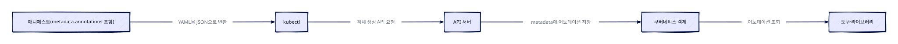

> 🤖 이 글은 공식문서를 근거로 **AI가 자동 생성**한 학습 노트입니다.

> 한 줄 요약: 어노테이션은 쿠버네티스 객체의 `metadata`에 붙이는 임의의 비식별 메타데이터다. 레이블과 달리 객체 선택에는 쓰이지 않으며, 키와 값이 모두 문자열이어야 하고 접두사 규칙과 객체당 256KiB 크기 제한을 따른다.

### 개요
**어노테이션**(annotation)은 쿠버네티스 객체의 `metadata`에 붙이는 임의의 비식별(non-identifying) 메타데이터다. 쿠버네티스 객체는 클러스터의 상태를 나타내는 영속 엔티티이며, 객체를 생성하는 것은 "이런 워크로드가 실행되길 원한다"는 의도를 시스템에 선언하는 일이다. 이 선언이 곧 클러스터의 desired state가 되고, 객체 생성 매니페스트에는 `apiVersion`, `kind`, `metadata`, `spec` 같은 필수 필드를 설정해야 한다.

도구나 라이브러리는 어노테이션의 메타데이터를 조회할 수 있으므로, 객체를 식별하는 데 쓰이지 않는 부가 정보를 객체와 함께 보관할 수 있다. 어노테이션은 객체를 식별하거나 선택하는 용도가 아니라는 점에서 레이블과 근본적으로 다르며, 객체에 대한 설명과 운영 정보를 담는 기본 수단으로 쓰인다.

### 어노테이션의 역할: 레이블과의 차이
**레이블**과 어노테이션은 둘 다 객체에 메타데이터를 붙이는 수단이지만 용도가 다르다. 레이블은 객체를 선택하고 특정 조건을 만족하는 객체의 집합을 찾는 데 사용된다. 반면 어노테이션은 객체의 식별과 선택에 사용되지 않는다. 같은 객체의 `metadata` 안에 레이블과 어노테이션을 함께 둘 수도 있다.

담을 수 있는 정보의 성격도 다르다. 어노테이션의 메타데이터는 작을 수도 크고, 구조적일 수도 비구조적일 수도 있으며, 레이블이 허용하지 않는 문자도 포함할 수 있다. 다만 키와 값은 모두 문자열이어야 하고, 숫자·불리언·리스트 같은 다른 타입은 키나 값 어디에도 쓸 수 없다.

공식 문서가 제시하는 어노테이션 활용 예시는 다음과 같다.

- 선언적 설정 계층이 관리하는 필드: 이 필드들을 어노테이션으로 붙이면 클라이언트나 서버가 설정한 기본값, 자동 생성 필드, 오토 스케일링 시스템이 설정한 값과 구분할 수 있다.
- 빌드·릴리스·이미지 정보: 타임스탬프, 릴리스 ID, git 브랜치, PR 번호, 이미지 해시, 레지스트리 주소.
- 로깅·모니터링·분석·감사 저장소를 가리키는 포인터.
- 디버깅에 쓰는 클라이언트 라이브러리나 도구 정보(이름, 버전, 빌드 정보).
- 사용자 또는 도구·시스템의 출처(provenance) 정보. 예를 들어 다른 에코시스템 컴포넌트의 관련 객체 URL.
- 가벼운 롤아웃 도구의 메타데이터(설정이나 체크포인트).
- 책임자의 전화·페이지 번호, 또는 팀 웹사이트처럼 그 정보를 찾을 수 있는 디렉터리 항목.
- 엔드유저가 구현체에 행동 변경을 요청하거나 비표준 기능을 쓰게 하는 지시문.

이런 정보는 어노테이션 대신 외부 데이터베이스나 디렉터리에 저장할 수도 있다. 하지만 그러면 배포·관리·내부 조사(introspection)를 위한 공유 클라이언트 라이브러리와 도구를 만들기가 훨씬 어려워진다. 객체에 함께 두는 것이 도구와 라이브러리의 접근성을 높이는 이유다.



<figure class="ai-scene"><figcaption>같은 키를 레이블로 넣으면 선택되고, 어노테이션으로 넣으면 왜 안 될까? · 설명용 시각화</figcaption><iframe class="ai-scene-frame" src="/assets/generated/designs/2026-11-08-쿠버네티스-어노테이션-비식별-메타데이터의-역할과-규칙-8c7c33bd5bd4decc-1.html" title="같은 키를 레이블로 넣으면 선택되고, 어노테이션으로 넣으면 왜 안 될까?" sandbox="allow-scripts" referrerpolicy="no-referrer" loading="lazy" height="560"></iframe><p class="ai-scene-summary">화면의 Pod 이름·키·값은 설명용이다. mechanism은 공식 문서의 규칙을 따른다: 레이블은 객체를 선택하는 데 쓰이고, 어노테이션은 객체 식별·선택에 쓰이지 않는다. selector는 레이블만 본다.</p></figure>


### 키/값 문법과 문자 제약
어노테이션은 레이블과 마찬가지로 키/값 쌍의 맵이다. 유효한 키는 선택적 `prefix`와 `name` 두 세그먼트로 이루어지며 슬래시(`/`)로 구분한다. `name` 세그먼트는 필수이고 63자 이하여야 하며, 영숫자(`[a-z0-9A-Z]`)로 시작하고 끝나야 한다. 그 사이에는 대시(`-`), 밑줄(`_`), 점(`.`)과 영숫자가 올 수 있다.

`prefix`는 선택이다. 지정한다면 DNS 서브도메인 형식을 따라야 하는데, 점으로 구분된 일련의 DNS 레이블로 구성되고 총 길이가 253자를 넘지 않아야 하며 뒤에 슬래시가 붙는다. `prefix`를 생략한 키는 사용자에게 비공개인 것으로 간주된다. 자동화된 시스템 컴포넌트(`kube-scheduler`, `kube-controller-manager`, `kube-apiserver`, `kubectl` 등)나 서드파티 자동화가 엔드유저 객체에 어노테이션을 추가할 때는 반드시 `prefix`를 지정해야 한다. 또한 `kubernetes.io/`와 `k8s.io/` 접두사는 쿠버네티스 코어 컴포넌트용으로 예약되어 있다.

값의 문자 제약은 레이블과 달리 없다. 어노테이션 값에는 특수 문자, 공백, 그리고 JSON이나 YAML 같은 구조적 데이터를 포함한 임의의 문자열이 들어갈 수 있다. 바이너리 데이터(예: CBOR)를 저장하려면 base64로 인코딩할 것을 권장한다. 단, 단일 객체에 존재하는 모든 어노테이션(키와 값 전체)의 총 크기는 256KiB를 넘을 수 없다.

### 객체 모델에서의 어노테이션 위치와 예시
쿠버네티스 객체는 대부분 `spec`과 `status`라는 두 중첩 필드를 가진다. `spec`은 객체를 생성할 때 사용자가 설정하는 desired state이고, `status`는 쿠버네티스 시스템이 공급하고 갱신하는 current state다. 컨트롤 플레인은 객체의 실제 상태가 사용자가 제공한 `spec`과 일치하도록 계속 관리한다. 예를 들어 Deployment의 `spec`에서 복제본 3개를 요청하면 시스템은 인스턴스 3개를 시작하고 `status`를 갱신한다. 인스턴스 하나가 실패하면 시스템은 `spec`과 `status`의 차이에 대응해 교체 인스턴스를 시작한다.

객체를 생성하는 API 요청에는 desired state를 설명하는 `spec`과 이름 같은 기본 정보를 JSON으로 담아야 한다. 일반적으로는 YAML 매니페스트를 작성하고 `kubectl apply` 같은 명령을 사용한다. `kubectl`은 매니페스트의 정보를 JSON 등 직렬화 형식으로 변환해 HTTP API 요청을 만든다. `metadata`는 `name` 문자열, `UID`, 선택적 `namespace` 등을 담아 객체를 식별하는 필드이며, 어노테이션은 그 아래에 추가된다. 어노테이션이 포함된 Pod 매니페스트의 예는 다음과 같다.

```yaml
apiVersion: v1
kind: Pod
metadata:
  name: annotations-demo
  annotations:
    imageregistry: "https://hub.docker.com/"
spec:
  containers:
  - name: nginx
    image: nginx:1.14.2
    ports:
    - containerPort: 80
```

매니페스트의 어노테이션이 객체에 저장되고 도구가 조회하기까지의 흐름은 다음과 같다.



### 정리
어노테이션은 쿠버네티스 객체의 `metadata`에 붙이는 비식별 메타데이터다. 레이블과 달리 객체 선택에 쓰이지 않으므로, 구조적이든 비구조적이든 임의의 문자열 정보를 객체와 함께 보관할 수 있다.

단, 키와 값이 모두 문자열이어야 한다는 제약과 키의 `prefix`/`name` 형식을 지켜야 하고, 단일 객체의 모든 어노테이션 크기는 256KiB를 넘을 수 없다. 자동화 컴포넌트가 추가하는 키에는 `prefix`가 필수이며, `kubernetes.io/`와 `k8s.io/` 접두사는 코어 컴포넌트 전용이다.

선언적 설정 필드, 빌드·릴리스 정보, 모니터링 저장소 포인터, 출처 정보, 롤아웃 도구 메타데이터, 책임자 연락처, 동작 변경 지시문 같은 부가 정보를 어노테이션에 담으면 외부 저장소보다 공유 도구와 라이브러리로 접근하기 쉽다.

---
> 🤖 작성 모델: `deepseek/deepseek-v4-flash-0731` (OpenRouter)
> 
> 참고한 공식문서:
> - [https://kubernetes.io/docs/concepts/overview/working-with-objects/annotations/](https://kubernetes.io/docs/concepts/overview/working-with-objects/annotations/)
> - [https://kubernetes.io/docs/concepts/overview/working-with-objects/](https://kubernetes.io/docs/concepts/overview/working-with-objects/)
