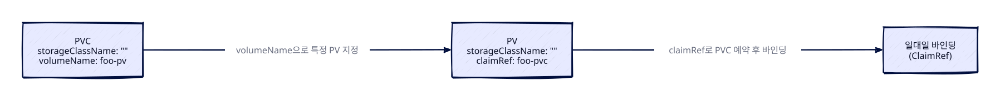

> 🤖 이 글은 공식문서를 근거로 **AI가 자동 생성**한 학습 노트입니다.

> 한 줄 요약: PVC의 `storageClassName`을 생략하면 기본 StorageClass가 자동으로 설정되어 동적 프로비저닝이 발생할 수 있다. 빈 문자열 `""`을 명시하면 어떤 StorageClass에도 속하지 않게 되어, 기본 클래스의 개입 없이 특정 PV와의 선결합을 수행할 수 있다.

### 개요
Kubernetes에서 스토리지 관리는 컴퓨팅 인스턴스 관리와 다른 문제다. PersistentVolume 서브시스템은 "스토리지를 어떻게 제공하는가"와 "스토리지를 어떻게 소비하는가"를 분리하기 위해 PersistentVolume(PV)과 PersistentVolumeClaim(PVC)이라는 두 API 리소스를 제공한다. PV는 클러스터의 저장소 자원이고, PVC는 사용자의 저장소 요청이다. 이 둘을 연결하는 과정에서 StorageClass가 개입하며, PVC의 `storageClassName` 필드 값이 어떤 StorageClass를 사용할지 결정한다. 이때 필드를 생략하는 것과 빈 문자열 `""`을 명시하는 것은 전혀 다른 의미를 가진다.

### PV와 PVC: 저장소를 추상화하는 두 리소스
PV는 관리자가 프로비저닝했거나 StorageClass를 통해 동적으로 프로비저닝된 클러스터의 저장소 조각이다. 노드가 클러스터 자원인 것처럼 PV도 클러스터 자원이며, PV를 사용하는 개별 Pod와 독립적인 라이프사이클을 가진다. PV 객체는 NFS, iSCSI, 클라우드 제공자의 스토리지 시스템 등 실제 저장소 구현의 세부 사항을 담는다.

PVC는 사용자의 저장소 요청이다. Pod가 노드 자원을 소비하듯 PVC는 PV 자원을 소비한다. Pod가 CPU와 메모리의 특정 수준을 요청할 수 있는 것처럼, PVC는 특정 크기와 접근 모드(ReadWriteOnce, ReadOnlyMany, ReadWriteMany, ReadWriteOncePod 등)를 요청할 수 있다.

제어 플레인의 컨트롤 루프는 새 PVC를 감시하고, 가능하면 일치하는 PV를 찾아 둘을 바인딩한다. PVC와 PV의 바인딩은 ClaimRef를 통한 일대일 매핑이며, 양방향 바인딩이다. 일치하는 볼륨이 없으면 PVC는 무기한 unbound 상태로 남고, 이후 일치하는 볼륨이 나타나면 바인딩된다.

### StorageClass와 동적 프로비저닝
사용자는 성능 등 크기와 접근 모드 외의 다양한 속성을 가진 PV가 필요하다. 관리자는 다양한 속성의 PV를 제공하면서도 구현 세부 사항을 사용자에게 노출하지 않아야 한다. 이 요구를 위해 StorageClass 리소스가 존재한다.

PV 프로비저닝에는 정적(static)과 동적(dynamic) 두 방식이 있다. 정적 방식은 관리자가 실제 저장소의 세부 정보를 담은 PV를 미리 만들어 Kubernetes API에 등록하는 것이다. 동적 방식은 관리자가 만든 정적 PV 중 사용자의 PVC와 일치하는 것이 없을 때, PVC를 위해 볼륨을 특별히 프로비저닝하는 것이다.

동적 프로비저닝은 StorageClass를 기반으로 동작한다. PVC가 StorageClass를 요청해야 하고, 관리자가 해당 클래스를 만들어 동적 프로비저닝용으로 구성해야 한다. 기본 StorageClass 기반의 동적 프로비저닝을 활성화하려면 API 서버에서 `DefaultStorageClass` admission controller를 켜야 한다. 이때 `""` 클래스를 요청하는 PVC는 스스로 동적 프로비저닝을 비활성화한다.

### `storageClassName: ""`를 명시해야 하는 이유
개념 문서의 PVC 예제는 `storageClassName` 필드에 대해 "빈 문자열은 명시적으로 설정해야 한다. 그렇지 않으면 기본 StorageClass가 설정된다"고 주석으로 경고한다. 즉 필드를 생략하면 기본 StorageClass가 자동으로 설정되고, PVC는 StorageClass를 요청한 상태가 된다. 관리자가 만든 정적 PV 중 일치하는 것이 없으면 클러스터는 PVC를 위해 볼륨을 동적으로 프로비저닝할 수 있다.

반면 `storageClassName: ""`을 명시하면 어떤 StorageClass에도 속하지 않는 PVC가 된다. PV API 참조도 `storageClassName`의 빈 값이 "이 볼륨이 어떤 StorageClass에도 속하지 않음"을 의미한다고 설명한다. 따라서 기본 StorageClass의 개입을 원하지 않는다면 빈 문자열을 반드시 명시해야 한다.

이 차이는 특정 PV에 직접 결합하려는 경우에 중요하다. PVC의 `volumeName` 필드로 특정 PV를 지정하면 해당 PV와 PVC가 바인딩된다. 이때 `storageClassName`을 생략하면 기본 StorageClass가 설정되어 버리므로, 원치 않는 클래스가 개입하지 않도록 `""`을 함께 명시해야 한다.

```yaml
apiVersion: v1
kind: PersistentVolumeClaim
metadata:
  name: foo-pvc
  namespace: foo
spec:
  storageClassName: ""  # 명시하지 않으면 기본 StorageClass가 설정됨
  volumeName: foo-pv
```



<figure class="ai-scene"><figcaption>storageClassName 생략 vs &quot;&quot; 명시 — 동적 프로비저닝과 선결합 · 설명용 시각화</figcaption><iframe class="ai-scene-frame" src="/assets/generated/designs/2026-11-09-storageclassname-를-명시해야-하는-이유-기본-storageclass-회피와-pv-선결합-b3ccd55740304d0c-1.html" title="storageClassName 생략 vs &quot;&quot; 명시 — 동적 프로비저닝과 선결합" sandbox="allow-scripts" referrerpolicy="no-referrer" loading="lazy" height="560"></iframe><p class="ai-scene-summary">같은 PVC 요청에서 storageClassName의 두 설정을 비교한다. 기본 StorageClass가 있고 DefaultStorageClass admission controller가 활성화된 클러스터를 가정한다. foo-pvc·foo-pv는 설명용 이름이며, 요청은 그대로 두고 설정·클래스 소속·동적 프로비저닝 판정만 달라진다.</p></figure>


### 특정 PV로의 선결합(pre-binding)
제어 플레인은 PVC를 일치하는 PV에 바인딩할 수 있지만, PVC를 특정 PV에 바인딩하려면 사전에 **선결합(pre-binding)**해야 한다. PVC의 `spec.volumeName`에 PV 이름을 지정하면 특정 PV와 PVC 사이의 바인딩을 선언하는 것이다. PV가 존재하고 `claimRef` 필드로 다른 PVC를 예약하지 않았다면 둘은 바인딩된다.

이 바인딩은 노드 선호도(node affinity)를 포함한 일부 볼륨 일치 기준과 무관하게 발생한다. 다만 제어 플레인은 여전히 StorageClass, 접근 모드, 요청된 저장소 크기가 유효한지 검사한다.

반대 방향의 예약도 가능하다. PV의 `claimRef` 필드에 관련 PVC를 지정하면 다른 PVC가 그 PV에 바인딩할 수 없다. 이 방식은 `persistentVolumeReclaimPolicy`가 `Retain`으로 설정된 PV를 소비하거나 기존 PV를 재사용할 때 유용하다.

```yaml
apiVersion: v1
kind: PersistentVolume
metadata:
  name: foo-pv
spec:
  storageClassName: ""
  claimRef:
    name: foo-pvc
    namespace: foo
```



`Retain` 정책은 수동 재확보를 위한 정책이다. 수동으로 만든 PV의 기본값은 `Retain`이고, 동적으로 프로비저닝된 볼륨은 StorageClass의 reclaim policy를 상속하며 기본값이 `Delete`다. `Delete`에서는 PVC를 삭제하면 볼륨도 함께 삭제되므로, 소중한 데이터가 담긴 볼륨이라면 `Retain`이 더 적절하다. `Retain`에서는 PVC가 삭제되어도 PV가 삭제되지 않고 `Released` 단계로 이동하며, 관리자가 데이터를 수동으로 복구할 수 있다.

### 정리
`storageClassName` 필드를 생략하면 기본 StorageClass가 자동으로 설정되고, PVC는 그 클래스를 요청한 것으로 간주되어 동적 프로비저닝이 발생할 수 있다. `storageClassName: ""`을 명시하면 어떤 StorageClass에도 속하지 않게 되므로 동적 프로비저닝이 비활성화된다. 이는 특정 PV를 `volumeName`으로 지정해 선결합할 때 특히 중요하다. PV 쪽에서도 `claimRef`로 PVC를 예약하면 다른 PVC의 바인딩을 막을 수 있으며, `Retain` 정책의 PV를 재사용하는 시나리오에서 유용하다.

---
> 🤖 작성 모델: `deepseek/deepseek-v4-flash-0731` (OpenRouter)
> 
> 참고한 공식문서:
> - [https://kubernetes.io/docs/concepts/storage/persistent-volumes/](https://kubernetes.io/docs/concepts/storage/persistent-volumes/)
> - [https://kubernetes.io/docs/reference/kubernetes-api/config-and-storage-resources/persistent-volume-v1/](https://kubernetes.io/docs/reference/kubernetes-api/config-and-storage-resources/persistent-volume-v1/)
> - [https://kubernetes.io/docs/tasks/administer-cluster/change-pv-reclaim-policy/](https://kubernetes.io/docs/tasks/administer-cluster/change-pv-reclaim-policy/)
