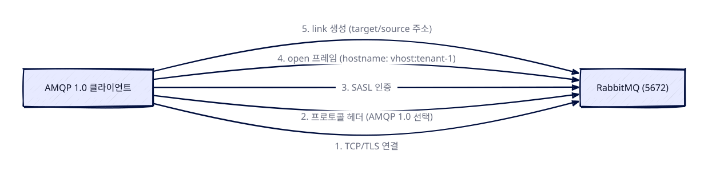

> 🤖 이 글은 공식문서를 근거로 **AI가 자동 생성**한 학습 노트입니다.

> 한 줄 요약: RabbitMQ 4.0부터 AMQP 1.0을 네이티브로 지원하며, 0.9.1과 같은 5672 포트에서 프로토콜 헤더로 버전을 협상한다. exchange/queue 기반 주소 체계와 outcome 기반 전송 결과 확인으로 메시지를 안전하게 주고받는다.

### 개요
AMQP 1.0은 OASIS와 ISO/IEC 19464로 표준화된 메시징 프로토콜이다. RabbitMQ 4.0부터 AMQP 1.0을 네이티브로 지원하며, 별도 플러그인 없이 AMQP 0.9.1과 함께 기본 포트 5672에서 동시에 수용한다. 클라이언트는 TCP/TLS 연결을 맺은 뒤 AMQP 프레임을 보내기 전에 프로토콜 헤더를 전송해 사용할 프로토콜 버전을 선택한다. AMQP 1.0을 선택한 연결에는 SASL 인증이 필수이며, RabbitMQ는 이를 사용하지 않는 연결을 거부한다.

### 연결과 인증
RabbitMQ는 AMQP 1.0과 AMQP 0.9.1을 모두 기본 지원하며, 두 프로토콜 모두 기본 포트 5672에서 연결을 받는다. 클라이언트는 TCP 또는 TLS 연결을 수립한 후, AMQP 프레임을 보내기 전에 프로토콜 헤더를 보내 AMQP 1.0을 사용할지 AMQP 0.9.1을 사용할지 알린다. 이는 AMQP 1.0 명세의 버전 협상 절차에 따른 것이다.

AMQP 1.0 연결에는 SASL(Simple Authentication and Security Layer) 사용이 필수다. 클라이언트가 SASL을 사용하지 않으면 RabbitMQ는 연결을 거부한다. RabbitMQ의 AMQP 1.0 구현이 지원하는 인증 방법은 다음과 같다.

- 사용자 이름/비밀번호 쌍: 지원되는 인증 백엔드 조합과 함께 사용할 수 있으며, 와이어 암호화를 위해 TLS와 함께 쓰는 것이 가장 좋다.
- JWT 토큰(OAuth 2)
- x.509 인증서: `EXTERNAL` 인증 메커니즘과 `rabbitmq_auth_mechanism_ssl` 플러그인을 통해 사용한다.

가상 호스트를 통한 논리적 멀티 테넌시도 지원한다. 연결 애플리케이션이 가상 호스트를 명시하지 않으면 `rabbitmq.conf`의 `default_vhost` 설정을 사용한다. AMQP 1.0 클라이언트는 `open` 프레임의 `hostname` 필드 값에 `vhost:` 접두사를 붙여 다른 가상 호스트에 연결할 수 있다. 예를 들어 `tenant-1` 가상 호스트에 연결하려면 `hostname` 필드를 `vhost:tenant-1`로 설정한다.

연결 수립 과정을 순서대로 정리하면 다음과 같다.

### 주소 체계
AMQP 1.0의 address는 메시지를 보내거나 소비할 위치를 결정한다. 그러나 address가 내부적으로 어떤 객체를 가리키는지, 어떻게 해석되는지는 AMQP 1.0 명세가 정의하지 않으며 브로커마다 다르게 해석할 수 있다. RabbitMQ는 exchange, queue, binding으로 구성된 AMQ 0.9.1 모델을 구현하므로, RabbitMQ에 연결하는 AMQP 클라이언트는 exchange로 메시지를 보내고 queue에서 메시지를 소비한다. 따라서 RabbitMQ가 이해하고 해석하는 AMQP address에는 exchange 이름, queue 이름, 라우팅 키가 포함된다.

퍼블리셔가 사용하는 target address 형식은 네 가지다.

| 형식 | 동작 |
| --- | --- |
| `/exchanges/:exchange/:routing-key` | 링크의 모든 메시지를 라우팅 키 `:routing-key`로 exchange `:exchange`에 전송한다. |
| `/exchanges/:exchange` | 빈 라우팅 키 `""`로 exchange `:exchange`에 전송한다. fanout이나 headers처럼 라우팅 키를 무시하는 exchange 타입에 유용하다. |
| `/queues/:queue` | queue `:queue`로 직접 전송한다. 큐는 반드시 존재해야 하며, 내부적으로는 기본 exchange를 사용하므로 `amq.default` exchange에 쓰기 권한이 필요하다. |
| `<null>` | 메시지별로 `properties` 섹션의 `to` 필드에 목적지를 지정한다. |

첫 번째와 두 번째 형식에서 기본 exchange `""`를 지정하는 것은 허용되지 않으며, 큐로 보낼 때는 세 번째 형식을 사용해야 한다. 처음 세 형식은 링크의 모든 메시지에 대해 target address가 동일해야 한다. 같은 링크에서 메시지마다 다른 exchange, 라우팅 키, 큐를 지정해야 한다면 네 번째 null 형식을 사용한다.

null 형식은 AMQP 확장 "Using the AMQP Anonymous Terminus for Message Routing"에 따라 각 메시지의 `to` 필드가 반드시 설정되어야 한다. 허용되는 `to` 문자열도 위의 세 형식과 같으며, exchange는 반드시 존재해야 한다. 메시지를 라우팅할 수 없을 때, 예를 들어 대상 exchange에 바인딩된 큐가 없으면 RabbitMQ는 `released` outcome으로 메시지를 settle한다.

목적지 수에 따른 권장 선택은 다음과 같다.

- 단일 목적지: 처음 세 문자열 형식이 null 형식보다 성능이 약간 좋으므로 문자열 형식을 선호한다.
- 소수의 서로 다른 목적지: 목적지마다 링크를 하나씩 열고 처음 세 형식을 사용한다.
- 많은 서로 다른 목적지: null 형식을 사용하고 각 메시지의 `to` 필드에 목적지를 지정한다.

컨슈머가 사용하는 source address로 유효한 문자열 형식은 `/queues/:queue` 하나뿐이며, 큐는 반드시 존재해야 한다.

Exchange 이름, 라우팅 키, queue 이름은 RFC 3986에 따라 percent-encoding해야 한다. 예를 들어 exchange `amq.direct`에 라우팅 키 `my-routing_key/123`으로 보내려면 target address를 `/exchanges/amq.direct/my-routing_key%2F123`으로 설정한다. percent-encoding은 address가 필요한 모든 AMQP 필드, 즉 target의 `address`, source의 `address`, 메시지 properties의 `to`와 `reply-to`에 적용해야 한다.

### 메시지 처리와 Outcome
메시지가 컨슈머에게 전달될 때 RabbitMQ는 최소 두 개의 메시지 애노테이션을 설정한다. `x-exchange`는 메시지가 원래 발행된 exchange, `x-routing-key`는 원래 발행에 사용된 라우팅 키를 나타낸다. 이 값들은 메시지가 RabbitMQ에 원래 어떻게 보내졌는지에 따라 다른 경로에서 파생된다. AMQP 1.0 퍼블리셔가 연결한 target의 `address` 필드, AMQP 1.0 메시지 properties의 `to` 필드, AMQP 0.9.1 `basic.publish` 프레임의 `exchange`/`routing_key` 필드, MQTT PUBLISH 패킷의 토픽 이름, RabbitMQ stream 프로토콜로 발행된 경우 스트림 이름 등이 그 출처다.

단, AMQP 1.0 클라이언트는 `x-exchange`나 `x-routing-key` 애노테이션을 붙여 메시지를 발행해서는 안 된다. RabbitMQ는 이를 해석하지 않는다. 원래 exchange와 라우팅 키로 메시지를 다시 발행하려면 address를 그에 맞게 설정해야 한다.

Outcome은 수신자에서의 메시지 처리 결과를 나타낸다. 클라이언트가 송신자(퍼블리셔)이고 RabbitMQ가 수신자일 때의 outcome은 다음과 같다.

| AMQP 1.0 Outcome | AMQP 0.9.1 프레임 | 의미 |
| --- | --- | --- |
| `Accepted` | `basic.ack` | 메시지가 라우팅된 모든 큐가 수락했다. quorum queue의 경우 과반수 replica가 메시지를 디스크에 기록했음을 의미하며, 퍼블리셔는 메시지를 잊거나 삭제할 수 있다. |
| `Rejected` | `basic.nack` | 최소 하나의 큐가 거부했다. 큐 길이 제한 초과(`overflow`가 `reject-publish`일 때) 또는 대상 classic queue를 사용할 수 없는 경우다. `error` 필드의 `info` 맵에 큐 이름(`queue`)과 사유(`reason`: `maxlen` 또는 `unavailable`)가 담긴다. `to` 필드의 address가 잘못되었거나 존재하지 않는 exchange를 가리켜도 거부된다. |
| `Released` | `basic.return` 후 `basic.ack`/`basic.nack` | 메시지를 어떤 큐로도 라우팅하지 못했다. 대상 exchange에 매칭되는 큐가 바인딩되지 않은 토폴로지 설정 오류를 의미한다. |
| `Modified` | - | RabbitMQ는 현재 `modified` outcome으로 메시지를 settle하지 않는다. |

클라이언트가 수신자(컨슈머)이고 RabbitMQ가 송신자일 때의 outcome은 다음과 같다.

| AMQP 1.0 Outcome | AMQP 0.9.1 프레임 | 의미 |
| --- | --- | --- |
| `Accepted` | `basic.ack` | 컨슈머가 메시지를 성공적으로 처리했으며 RabbitMQ는 메시지를 삭제할 수 있다. |
| `Rejected` | `basic.nack` 또는 `requeue=false`인 `basic.reject` | 메시지가 유효하지 않아 처리할 수 없음을 나타낸다. RabbitMQ는 데드 레터링을 수행하며, 데드 레터링이 설정되지 않았으면 메시지를 버린다. |
| `Released` | `basic.nack` 또는 `requeue=true`인 `basic.reject` | 컨슈머가 메시지를 처리하지 않았다. RabbitMQ는 메시지를 재큐잉하며, 같은 컨슈머나 다른 컨슈머에게 전달된다. |
| `Modified` | - | 컨슈머가 메시지를 처리하지 않았지만 메시지 애노테이션을 수정했다. `undeliverable-here=true`면 데드 레터링(또는 미설정 시 버림)하고, `false`면 재큐잉한다. |


<figure class="ai-scene"><figcaption>같은 발행인데 왜 Accepted·Rejected·Released가 갈리나? · 설명용 시각화</figcaption><iframe class="ai-scene-frame" src="/assets/generated/designs/2026-11-10-rabbitmq의-amqp-1-0-연결-인증부터-주소-체계와-outcome까지-9d93adeec0a64dc2-1.html" title="같은 발행인데 왜 Accepted·Rejected·Released가 갈리나?" sandbox="allow-scripts" referrerpolicy="no-referrer" loading="lazy" height="560"></iframe>
exchange·라우팅 키·메시지는 설명용 예시다. 규칙은 RabbitMQ outcome 표에 따른다. 같은 발행 요청에서 수신 처리 결과만 바뀐다.
</figure>


### 프로토콜 상호운용성
RabbitMQ는 서로 다른 프로토콜 간 메시지 발행·소비를 지원하며, 이를 위해 프로토콜 변환이 필요하다. AMQP 1.0으로 발행된 메시지는 classic queue, quorum queue, stream 등 모든 대상 큐 타입에 원본 AMQP 1.0 형식 그대로 저장된다. 이후 AMQP 1.0으로 소비하면 프로토콜 변환이 필요 없다. 또한 AMQP 1.0 명세가 요구하는 bare message 불변성 덕분에 클라이언트는 메시지 본문뿐 아니라 properties와 application-properties 섹션에 대해서도 해시, 체크섬, 전자서명을 설정할 수 있다.

AMQP 1.0은 AMQP 0.9.1보다 현대적인 프로토콜로, ISO/IEC 19464와 OASIS 표준이다. 반면 AMQP 0.9.1은 공식 표준이 아니다. 프로토콜 선택은 기능 요구사항, 상호운용성(AMQP 1.0을 지원하는 브로커가 AMQP 0.9.1보다 많다), 클라이언트 라이브러리 가용성 등을 고려해 결정한다.

### 공식 AMQP 1.0 클라이언트 라이브러리
RabbitMQ 팀은 RabbitMQ에 맞게 설계·최적화된 AMQP 1.0 클라이언트 라이브러리를 Java, .NET, Go, Python, JavaScript로 제공한다(Erlang 클라이언트도 공식 지원 목록에 있다). 이 라이브러리들은 AMQP 1.0 위에 단순하면서도 안전한 API를 제공하며, 언어에 관계없이 일관된 방식으로 메시지 발행·소비와 서버 토폴로지 관리를 할 수 있다. 자동 연결·토폴로지 복구와 큐에 대한 연결 선호도 같은 고급 기능도 포함한다. RabbitMQ는 AMQP 1.0 명세를 준수하는 어떤 클라이언트 라이브러리와도 호환되므로 공식 라이브러리가 필수는 아니지만, 최상의 경험을 위해 사용이 권장된다.

이 라이브러리들은 기본적으로 안전하게 동작한다. 항상 durable 엔티티를 생성하고 항상 persistent 메시지를 발행한다. 전송 보장은 at-least-once이며, 브로커는 발행된 메시지의 처리를 항상 확인한다. 퍼블리셔는 생성 시 `unsettled` sender settle 모드와 `first` receiver settle 모드를 사용하고, 컨슈머도 같은 설정을 사용해 메시지 처리 결과를 브로커에 반드시 알려야 한다.

API 구조는 environment → connection → publisher 순서다. environment는 노드 또는 클러스터의 진입점으로, 보통 애플리케이션 프로세스당 하나를 만들고 종료 시 닫아 자원을 해제한다. connection은 environment에서 열며 장수명 객체로 다뤄야 하고 잦은 생성·해제를 피해야 한다. 라이브러리는 기본적으로 `ANONYMOUS` SASL 인증 메커니즘을 사용한다.

퍼블리셔는 생성 시 목적지를 설정하거나, 목적지 없이 만든 뒤 메시지마다 `to` 필드로 목적지를 지정할 수 있다. 지원되는 목적지는 exchange+라우팅 키(`/exchanges/foo/bar`), exchange만(`/exchanges/foo`), 큐(`/queues/some-queue`)이며, 라이브러리 API 호출은 address format v2로 변환된다. 발행 결과는 비동기 콜백으로 전달되며, 클라이언트는 `ACCEPTED`, `RELEASED`, `REJECTED` 상태에 따라 적절한 조치를 취한다. 예를 들어 메시지가 수락되지 않았으면 다른 곳에 저장할 수 있다.

### 정리
RabbitMQ 4.0부터 AMQP 1.0은 네이티브로 지원되며, 같은 포트에서 AMQP 0.9.1과 공존한다. AMQP 1.0 연결은 SASL 인증이 필수이고, address는 RabbitMQ의 exchange/queue 모델에 따라 해석된다. 발행·소비 결과는 outcome으로 확인되며, 퍼블리셔와 컨슈머 각각의 settle 의미가 0.9.1의 ack/nack/return과 대응된다. 공식 클라이언트 라이브러리는 at-least-once 보장과 durable/persistent 기본값으로 안전한 사용을 돕는다.

---
> 🤖 작성 모델: `deepseek/deepseek-v4-flash-0731` (OpenRouter)
> 
> 참고한 공식문서:
> - [https://www.rabbitmq.com/docs/amqp](https://www.rabbitmq.com/docs/amqp)
> - [https://www.rabbitmq.com/client-libraries/amqp-client-libraries](https://www.rabbitmq.com/client-libraries/amqp-client-libraries)
> - [https://www.rabbitmq.com/client-libraries/devtools](https://www.rabbitmq.com/client-libraries/devtools)
