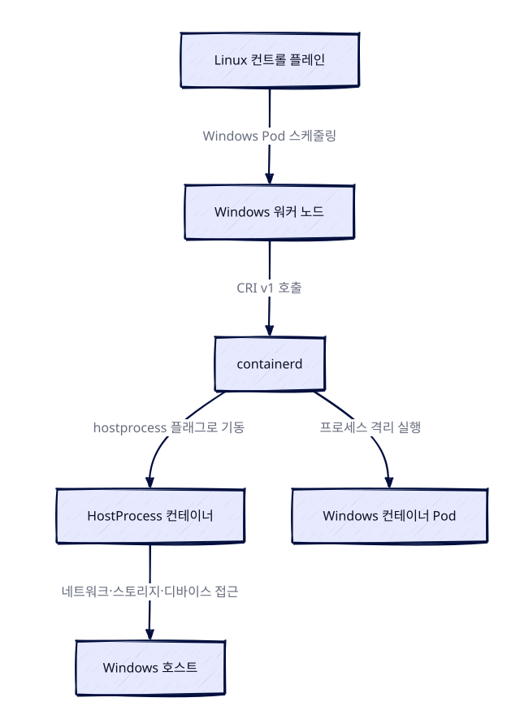

> 🤖 이 글은 공식문서를 근거로 **AI가 자동 생성**한 학습 노트입니다.

> 한 줄 요약: Linux 컨트롤 플레인 아래 Windows 워커 노드를 배치하고 프로세스 격리 컨테이너를 실행하는 쿠버네티스 구조에서, OS 버전 일치·API 호환성 제약·CRI 런타임과 cgroup 드라이버 일치·HostProcess 컨테이너가 핵심 축이다.

### 개요

Windows 애플리케이션은 많은 조직의 서비스에서 큰 비중을 차지한다. Windows 컨테이너는 프로세스와 패키지 의존성을 캡슐화하는 방법을 제공해서 Windows 애플리케이션에도 DevOps 관행과 클라우드 네이티브 패턴을 적용할 수 있게 한다. Windows와 Linux 양쪽에 투자한 조직은 별도의 오케스트레이터를 찾지 않고 쿠버네티스 하나로 두 운영체제의 워크로드를 관리할 수 있으므로 운영 효율이 높아진다.

이를 위해 기존 Linux 클러스터에 Windows 노드를 포함시킨다. 컨트롤 플레인은 Linux에서만 실행할 수 있지만, 워커 노드는 Windows 또는 Linux 중 하나로 배포할 수 있다. 이 글에서 "Windows 컨테이너"는 프로세스 격리(process isolation)를 의미하며, Hyper-V 격리는 지원되지 않는다.



이 구조에서 일반 Windows 워크로드는 Pod로 프로세스 격리 실행되고, 호스트 자원이 필요한 작업만 HostProcess 컨테이너로 분리된다.

### Windows 노드 구성과 OS 호환성

Windows 워커 노드를 도입할 때 먼저 짚어야 할 것은 OS 버전 일치 규칙, 하드웨어 기본값, 그리고 Windows 노드에서 달라지는 kubelet 동작이다.

Windows 노드에서는 호스트 OS 버전과 컨테이너 베이스 이미지 OS 버전이 일치해야 한다는 엄격한 호환성 규칙이 적용된다. v1.37 기준 지원되는 Windows Server LTSC 릴리스는 Windows Server 2022와 Windows Server 2025이며, 쿠버네티스의 version-skew 정책도 함께 적용된다. 하드웨어 권장 사양은 가상화를 지원하는 64비트 프로세서와 4코어 이상, 8GB 이상 RAM, 50GB 이상 여유 디스크다. 문서는 이를 최소 요구 사항이 아니라 합리적인 기본값으로 본다고 명시한다. GUI가 필요 없다면 Windows Desktop Experience가 제외된 Server 설치를 선택하는 것이 시스템 자원 확보에 유리하다. 디스크 산정 시 Windows 컨테이너 이미지는 단일 이미지가 300MB에서 10GB를 넘을 정도로 Linux보다 대체로 크다는 점도 고려해야 한다. Windows 컨테이너의 C: 드라이브가 기본 20GB의 가상 크기를 보여주는 것도 실제 소비 공간이 아니라 로컬 스토리지를 사용할 때 단일 컨테이너가 자랄 수 있는 크기다.

Windows 노드에는 지원되지 않는 기능도 있다. HugePages는 Windows 컨테이너에서 지원되지 않고, 특권(privileged) 컨테이너도 지원되지 않으며 유사한 기능은 HostProcess 컨테이너가 제공한다. `TerminationGracePeriod`는 containerd를 사용해야 하고, 공유 네임스페이스의 모든 기능이 지원되는 것은 아니다. kubelet 명령줄 옵션도 다르게 동작한다. `--windows-priorityclass`로 kubelet 프로세스의 스케줄링 우선순위를 정할 수 있고, `--kube-reserved`, `--system-reserved`, `--eviction-hard`는 NodeAllocatable을 갱신하지만 `--enforce-node-allocable`을 통한 축출은 구현되지 않았다. Windows 노드의 kubelet은 메모리나 CPU 제한이 없으며, 예약 플래그들은 NodeAllocatable에서 차감만 할 뿐 워크로드에 자원을 보장하지 않는다. PIDPressure 컨디션도 구현되지 않았고 kubelet은 OOM 축출 동작을 하지 않는다.

### Pod 스펙과 API 호환성 차이

Pod는 쿠버네티스 객체 모델에서 생성·배포하는 가장 작고 단순한 단위다. Windows와 Linux 컨테이너는 같은 Pod에 배포할 수 없으며, 한 Pod의 모든 컨테이너는 특정 플랫폼과 아키텍처를 나타내는 단일 노드에 스케줄링된다.

Windows Pod에 지원되는 기능은 Pod당 단일·다중 컨테이너(프로세스 격리와 볼륨 공유), Pod status 필드, readiness·liveness·startup 프로브, postStart·preStop 라이프사이클 훅, 환경 변수나 볼륨으로서의 ConfigMap·Secret, emptyDir 볼륨, named pipe 호스트 마운트, 리소스 한도다. 워크로드 리소스로 ReplicaSet, Deployment, StatefulSet, DaemonSet, Job, CronJob, ReplicationController를 쓸 수 있고, kubectl exec, Pod·컨테이너 메트릭, HPA, 리소스 쿼터, 스케줄러 선점도 지원된다.

Windows Pod임을 나타내려면 `.spec.os.name`을 `windows`로 설정해야 한다. 이 필드를 설정하면 해당 Pod의 `.spec`에서 지정할 수 없는 필드들이 생긴다.

| 범위 | 금지 필드 |
|---|---|
| Pod 수준 | `hostPID`, `hostIPC`, `shareProcessNamespace`, `securityContext`의 `seLinuxOptions`, `seccompProfile`, `fsGroup`, `fsGroupChangePolicy`, `sysctls`, `runAsUser`, `runAsGroup`, `supplementalGroups` |
| 컨테이너 수준 | `securityContext`의 `seLinuxOptions`, `seccompProfile`, `capabilities`, `readOnlyRootFilesystem`, `privileged`, `allowPrivilegeEscalation`, `procMount`, `runAsUser`, `runAsGroup` |

이 중 하나라도 지정되면 API 서버는 해당 Pod를 허용하지 않는다.

이런 제약은 근본적으로 OS 개념의 차이에서 나온다. Linux는 신원을 정수형 UID/GID로 표현하고, 사용자·그룹 이름은 `/etc/groups`나 `/etc/passwd`에서 UID+GID로 돌아가는 별칭일 뿐이다. Windows는 더 큰 이진 보안 식별자(SID)를 사용하며, 이는 Windows Security Access Manager(SAM) 데이터베이스에 저장된다. 이 데이터베이스는 호스트와 컨테이너 사이, 컨테이너 사이에서 공유되지 않는다. 파일 권한도 Windows는 SID 기반 ACL을 쓰는 반면 POSIX 계열은 객체 권한과 UID+GID 기반 비트마스크(선택적으로 ACL)를 쓴다. 경로 구분자는 Windows에서 `\`인데, Go IO 라이브러리는 보통 둘 다 받아들이지만 컨테이너 내부에서 해석되는 경로나 명령줄은 `\`가 필요할 수 있다. 종료 처리도 다르다. Windows 대화형 앱은 `WM_CLOSE` 같은 메시지를 UI 스레드가 처리하고, 콘솔 앱은 Ctrl-C/Ctrl-break를 Control Handler로 처리하며, 서비스는 `SERVICE_CONTROL_STOP` 제어 코드를 받는 Service Control Handler를 등록한다. 종료 코드 0은 성공, 0이 아니면 실패라는 규약은 같지만 구체적 오류 코드는 OS마다 다를 수 있고, kubelet·kube-proxy 같은 쿠버네티스 컴포넌트가 전달하는 종료 코드는 그대로다.

컨테이너 스펙 필드별 호환성 차이를 표로 정리하면 다음과 같다.

| 필드 | Windows에서의 동작 |
|---|---|
| `securityContext.privileged` | 특권 컨테이너 미지원, HostProcess 컨테이너로 대체 |
| `securityContext.capabilities` | POSIX capabilities 미구현 |
| `securityContext.allowPrivilegeEscalation` | 불가능, capabilities가 연결되지 않음 |
| `securityContext.procMount` | `/proc` 파일시스템이 없음 |
| `securityContext.readOnlyRootFilesystem` | 불가능, 레지스트리·시스템 프로세스 실행에 쓰기 필요 |
| `securityContext.runAsGroup` | GID 미지원으로 불가능 |
| `securityContext.runAsUser` | `runAsUserName`을 대신 사용 |
| `securityContext.runAsNonRoot` | `ContainerAdministrator`(Windows의 root에 가장 가까운 계정)로 실행되는 것만 막음 |
| `securityContext.seLinuxOptions` | SELinux는 Linux 전용이라 불가능 |
| `terminationMessagePath` | 단일 파일 매핑 미지원, 기본값 `/dev/termination-log`는 Windows에 기본적으로 없어서 동작 |
| Huge pages | Windows 컨테이너 런타임에 미구현, 컨테이너에 설정 불가능한 사용자 권한 요구 |

`requests.cpu`와 `requests.memory`는 노드 가용 자원에서 차감되어 노드 과다 프로비저닝을 피하는 데는 쓸 수 있지만, 과다 프로비저닝된 노드에서 자원을 보장하지는 못한다.

Pod 스펙에서도 차이가 있다. hostIPC·hostPID의 호스트 네임스페이스 공유와 hostNetwork 호스트 네트워킹은 Windows에서 불가능하다. 호스트 네트워킹이 제공되지 않으므로 `dnsPolicy`를 `ClusterFirstWithHostNet`으로 설정하는 것도 지원되지 않으며, Pod는 항상 컨테이너 네트워크로 실행된다. `shareProcessNamespace`는 Linux 네임스페이스에 의존해서 Windows에는 구현되지 않았고, 프로세스 네임스페이스나 컨테이너 루트 파일시스템은 공유할 수 없으며 네트워크만 공유된다. `terminationGracePeriodSeconds`는 Docker on Windows에서 완전히 구현되지 않았다. 현재 동작은 ENTRYPOINT 프로세스가 CTRL_SHUTDOWN_EVENT를 받은 뒤 기본 5초를 기다렸다가 일반 Windows 종료 방식으로 모든 프로세스를 종료하는 것이다. 이 5초 기본값은 컨테이너 내부 Windows 레지스트리에 있어 이미지 빌드 때 덮어쓸 수 있다. `volumeDevices`도 미구현이라 원시 블록 디바이스를 Pod에 연결할 수 없고, `emptyDir` 볼륨 소스를 `memory`로 설정하거나 `mountPropagation`을 켤 수 없다. v1.26부터 v1.32까지 알파로 제공되던 호스트 네트워크 네임스페이스 실행 지원은 v1.37에 포함되지 않으며 `WindowsHostNetwork` 기능 게이트도 없다. Pod 보안 컨텍스트에서 동작하는 필드는 `runAsNonRoot`와 `windowsOptions`뿐이다.

### 컨테이너 런타임과 cgroup 드라이버

Pod가 실행되려면 모든 노드에 컨테이너 런타임이 설치되어야 하고, Kubernetes 1.37은 CRI(Container Runtime Interface)를 준수하는 런타임을 요구한다. 쿠버네티스는 v1.26부터 CRI v1 API에서만 동작하며, 런타임이 v1 API를 지원하지 않으면 kubelet은 노드로 등록되지 않는다.

Windows 노드에서 동작하는 런타임으로 문서에 언급된 것은 containerd와 Mirantis Container Runtime(MCR)이다. containerd는 v1.20부터 stable이며 Windows 노드에는 containerd 1.4.0+를 쓸 수 있다. Windows의 기본 CRI 엔드포인트는 `npipe://./pipe/containerd-containerd`이고 Linux에서는 `/run/containerd/containerd.sock`이다. GMSA로 Windows 네트워크 공유에 접근할 때는 커널 패치가 필요한 알려진 제한이 있다. MCR은 예전 Docker Enterprise Edition으로, Windows Server 2019 이상에서 쓸 수 있다. Linux에서 Docker Engine을 쓸 때는 dockershim이 v1.24에서 제거되었으므로 `cri-dockerd` 어댑터로 통합한다.

Linux에서 cgroup은 프로세스에 할당되는 자원을 제약하는 데 쓰이며, kubelet과 컨테이너 런타임은 모두 cgroup에 인터페이스해야 한다. 여기서 cgroup 드라이버가 중요해진다. `cgroupfs` 드라이버는 kubelet의 기본값으로, kubelet과 런타임이 cgroup 파일시스템에 직접 인터페이스한다. 그러나 systemd가 init 시스템인 배포판에서 cgroupfs를 쓰면 systemd도 유닛마다 cgroup을 할당하는 cgroup 매니저 역할을 하므로, 시스템에 두 개의 cgroup 매니저가 생긴다. 두 매니저는 가용·사용 중 자원에 대한 서로 다른 두 관점을 만들고, 자원 압박이 있는 노드는 불안정해질 수 있다. 완화 방법은 systemd가 init 시스템일 때 kubelet과 런타임 모두 `systemd` cgroup 드라이버를 쓰는 것이다. cgroup v2를 쓸 때도 systemd 드라이버가 권장된다.

Kubernetes 1.37에서는 `KubeletCgroupDriverFromCRI` 기능 게이트가 켜져 있고 런타임이 `RuntimeConfig` CRI RPC를 지원하면, kubelet이 런타임에서 cgroup 드라이버를 자동 감지하고 kubelet 설정의 `cgroupDriver` 값을 무시한다. containerd 1.y 이하의 오래된 런타임은 이 RPC를 지원하지 않아 kubelet이 자신의 `--cgroup-driver` 플래그 값으로 폴백한다. 이 폴백 동작은 1.38에서 제거될 예정이므로, 오래된 containerd는 새 kubelet과 함께 쓰면 실패하게 된다. 한편 이미 조인한 노드의 cgroup 드라이버를 바꾸는 것은 민감하다. 기존 Pod 샌드박스를 다시 만들 때 오류가 발생할 수 있고 kubelet 재시작으로 해결되지 않을 수 있어서, 자동화가 가능하다면 노드를 교체하거나 재설치하는 편이 낫다.

Pod의 네트워크 구성을 유지하는 pause 컨테이너도 이해할 필요가 있다. 쿠버네티스 Pod에서는 먼저 인프라(또는 pause) 컨테이너가 생성되어 컨테이너를 호스팅한다. Linux에서 Pod를 구성하는 cgroups와 네임스페이스는 계속 존재하도록 유지할 프로세스가 필요하며 pause 프로세스가 이를 제공한다. 같은 Pod에 속한 컨테이너들은 인프라·워커 컨테이너를 포함해 공통 네트워크 엔드포인트(같은 IPv4/IPv6 주소, 같은 포트 공간)를 공유한다. 워커 컨테이너가 죽거나 재시작해도 네트워킹 설정을 잃지 않는 것은 pause 컨테이너 덕분이다. Kubernetes는 Windows를 포함한 멀티 아키텍처 pause 이미지를 유지하며, v1.37.0 권장 이미지는 `registry.k8s.io/pause:3.6`이다. Microsoft도 같은 소스에서 빌드하고 Windows 바이너리를 authenticode 서명한 `mcr.microsoft.com/oss/kubernetes/pause:3.6`을 제공하며, 서명된 바이너리가 필요한 프로덕션 환경에서는 이 이미지를 권장한다. containerd 설정에서 sandbox 이미지를 바꿀 수도 있고, 설정 변경 후에는 containerd를 재시작해야 한다.



<figure class="ai-scene"><figcaption>cgroup 드라이버 선택: systemd init 노드의 안정성 비교 · 설명용 시각화</figcaption><iframe class="ai-scene-frame" src="/assets/generated/designs/2026-11-11-쿠버네티스-windows-컨테이너-노드-구성-런타임-hostprocess-이해하기-cc11caf854a8cd3d-1.html" title="cgroup 드라이버 선택: systemd init 노드의 안정성 비교" sandbox="allow-scripts" referrerpolicy="no-referrer" loading="lazy" height="560"></iframe><p class="ai-scene-summary">systemd init Linux 노드에서 kubelet·런타임의 cgroup 드라이버 선택을 비교한다. &#x27;자원 압박 시 불안정&#x27;은 문서가 명시한 가능성이다.</p></figure>


### Windows HostProcess 컨테이너

HostProcess 컨테이너는 Windows 호스트 위에서 컨테이너화된 워크로드를 실행하는 기능으로 v1.26부터 stable이다. 일반 프로세스처럼 동작하면서 적절한 사용자 권한이 주어지면 호스트의 네트워크 네임스페이스, 스토리지, 디바이스에 접근할 수 있다. 네트워크 플러그인, 스토리지 구성, 디바이스 플러그인, kube-proxy 같은 컴포넌트를 전용 프록시나 호스트 서비스 직접 설치 없이 Windows 노드에 배포할 수 있고, 보안 패치 설치나 이벤트 로그 수집 같은 관리 작업도 노드에 로그온하지 않고 수행할 수 있다.

HostProcess 컨테이너는 호스트 또는 호스트의 도메인에서 사용 가능한 어떤 사용자로도 실행할 수 있어, 사용자 권한으로 호스트 자원 접근을 제한할 수 있다. 파일시스템이나 프로세스 격리는 지원되지 않지만, 컨테이너 시작 시 호스트에 새 볼륨이 생성되어 깨끗하고 통합된 작업 공간을 제공한다. 기존 Windows 베이스 이미지 위에 만들 수 있고, 일반 Windows 서버 컨테이너와 달리 베이스 이미지 버전이 호스트와 일치해야 한다는 호환성 요구를 상속하지 않는다. 다만 노드에 사용하지 않는 이미지를 남기지 않도록 워크로드와 같은 베이스 이미지 버전을 쓰는 것이 권장된다. 사용 시점은 호스트의 네트워킹 네임스페이스가 필요한 작업, 호스트 파일시스템·이벤트 로그 같은 자원 접근이 필요한 작업, 특정 디바이스 드라이버나 Windows 서비스 설치, 그리고 관리 작업과 보안 정책을 통합해 Windows 노드가 가진 권한 수준을 낮추고 싶을 때다.

#### 설정 요구사항과 제약

HostProcess Pod는 Pod Security Standards의 baseline과 restricted 정책에서 허용되지 않으므로 privileged 프로필에 맞춰 실행해야 한다. privileged 정책 아래에서 필요한 구성은 다음과 같다.

| 설정 | 값 |
|---|---|
| `securityContext.windowsOptions.hostProcess` | `true` |
| `hostNetwork` | `true` |
| `securityContext.windowsOptions.runAsUserName` | `NT AUTHORITY\SYSTEM`, `NT AUTHORITY\Local service`, `NT AUTHORITY\NetworkService` 또는 로컬 사용자 그룹 이름 |
| `runAsNonRoot` | 호스트에 대한 특권 접근 때문에 `true` 불가, Undefined/Nil 또는 `false` |

매니페스트 예시는 다음과 같다.

```yaml
spec:
  securityContext:
    windowsOptions:
      hostProcess: true
      runAsUserName: "NT AUTHORITY\\Local service"
  hostNetwork: true
  containers:
  - name: test
    image: image1:latest
    command: ["ping", "-t", "127.0.0.1"]
  nodeSelector:
    "kubernetes.io/os": windows
```

제약도 분명하다. containerd 1.6 이상이 필요하고 1.7이 권장된다. HostProcess Pod에는 HostProcess 컨테이너만 넣을 수 있는데, 이는 비특권 Windows 컨테이너가 호스트 IP 네임스페이스와 vNIC를 공유할 수 없다는 Windows OS 자체의 제한 때문이다. HostProcess 컨테이너는 호스트 위의 프로세스로 실행되며 HostProcess 사용자 계정에 부과된 자원 제약 외에는 격리가 없다. 파일시스템이나 Hyper-V 격리도 지원되지 않는다. named pipe 마운트와 Unix domain socket은 지원되지 않으므로 호스트 경로(예: `\\.\pipe\*`)로 접근해야 한다. 디스크·메모리·CPU 수 리소스 한도는 호스트 위의 프로세스와 같은 방식으로 지원된다.

#### 볼륨 마운트와 리소스 한도

HostProcess 컨테이너는 컨테이너 볼륨 공간 안에 볼륨을 마운트할 수 있으며, 동작은 containerd 버전에 따라 다르다. containerd v1.6에서는 컨테이너 생성 시 설정되는 `$CONTAINER_SANDBOX_MOUNT_POINT` 환경 변수가 컨테이너 볼륨의 절대 호스트 경로를 제공하고, 상대 경로는 `volumeMounts.mountPath`를 기준으로 한다. 예를 들어 서비스 어카운트 토큰은 `.\var\run\secrets\kubernetes.io\serviceaccount\` 또는 `$CONTAINER_SANDBOX_MOUNT_POINT\var\run\secrets\kubernetes.io\serviceaccount\`로 접근한다. containerd v1.7 이상에서는 Linux나 비-HostProcess Windows 컨테이너처럼 volumeMount에 지정한 mountPath로 직접 접근할 수 있고, 이전 버전 호환을 위해 상대 경로 방식도 그대로 동작한다.

리소스 한도는 잡(job) 전체에 적용된다. 예를 들어 10MB 메모리 한도를 설정하면 HostProcess 잡 객체에 할당되는 메모리가 10MB로 제한되며, 이는 다른 Windows 컨테이너 타입과 같은 동작이다. 디스크 자원 사용량 계산만 HostProcess 컨테이너의 부트스트랩 방식 차이로 인해 다르게 이루어진다.

#### 사용자 계정 선택과 트러블슈팅

기본적으로 HostProcess 컨테이너는 LocalSystem, LocalService, NetworkService 세 가지 Windows 서비스 계정 중 하나로 실행할 수 있다. LocalSystem은 세 계정 중 권한이 가장 높아 꼭 필요할 때만 써야 하고, 가능하면 가장 권한이 낮은 LocalService를 사용하는 것이 권장된다. 구성이 되어 있다면 로컬 사용자 계정으로도 실행할 수 있는데, 이 경우 노드에 로컬 사용자 그룹을 먼저 만들고 그 이름을 `runAsUserName`에 지정해야 한다. 컨테이너 초기화 전에 새 임시(ephemeral) 로컬 사용자 계정이 만들어져 해당 그룹에 조인되고, 컨테이너는 그 계정으로 실행된다. 덕분에 로컬 사용자 계정의 비밀번호를 관리할 필요가 없다. 예를 들어 `net localgroup hpc-localgroup /add`로 그룹을 만들고 `icacls`로 자원 접근 권한을 부여한 뒤 `runAsUserName: hpc-localgroup`을 설정하는 방식이며, 서비스 계정으로 실행하는 초기 HostProcess 컨테이너가 이후 컨테이너를 위한 사용자 그룹을 준비하는 데 쓰일 수 있다. 로컬 사용자 계정 실행은 containerd v1.7+가 필요하다.

트러블슈팅 관점에서, `failed to create user process token: failed to logon user: Access is denied.: unknown` 오류가 발생하면 containerd가 LocalSystem 또는 LocalService 서비스 계정으로 실행 중인지 확인해야 한다. 일반 사용자 계정(Administrator 포함)은 지원되는 사용자 계정에 대한 로그온 토큰을 만들 권한이 없기 때문이다.

### 정리

쿠버네티스의 Windows 컨테이너 지원은 Linux 컨트롤 플레인에 Windows 워커 노드를 섞는 구조로, 별도 오케스트레이터 없이 두 OS 워크로드를 한 클러스터에서 관리한다. Windows 노드에서는 호스트 OS와 베이스 이미지 버전 일치가 엄격히 요구되고 프로세스 격리만 지원되며, SID·ACL·경로·시그널 같은 OS 개념 차이 때문에 Pod 스펙과 보안 컨텍스트의 여러 필드가 제한된다. 런타임은 CRI v1을 준수해야 하고 kubelet과 런타임의 cgroup 드라이버를 일치시키는 것이 노드 안정성의 핵심이다. 호스트 네트워크와 호스트 자원이 필요한 작업은 HostProcess 컨테이너로 수행하며, 이는 특권 컨테이너를 대체하는 Windows 고유의 접근법이다.

---
> 🤖 작성 모델: `deepseek/deepseek-v4-flash-0731` (OpenRouter)
> 
> 참고한 공식문서:
> - [https://kubernetes.io/docs/concepts/windows/intro/](https://kubernetes.io/docs/concepts/windows/intro/)
> - [https://kubernetes.io/docs/setup/production-environment/container-runtimes](https://kubernetes.io/docs/setup/production-environment/container-runtimes)
> - [https://kubernetes.io/docs/tasks/configure-pod-container/create-hostprocess-pod/](https://kubernetes.io/docs/tasks/configure-pod-container/create-hostprocess-pod/)
