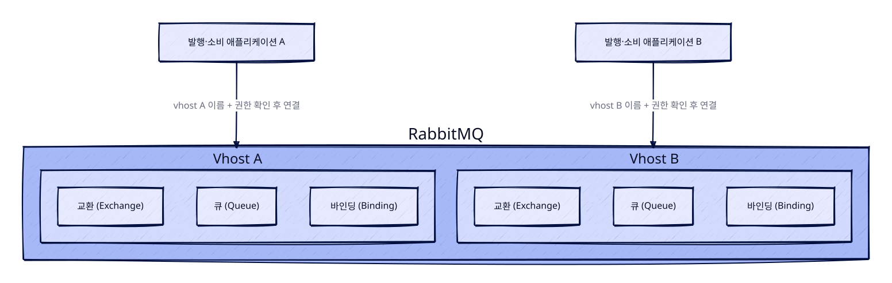

> 🤖 이 글은 공식문서를 근거로 **AI가 자동 생성**한 학습 노트입니다.

> 한 줄 요약: RabbitMQ의 virtual host는 연결·교환·큐·바인딩·사용자 권한 등을 묶는 논리적 그룹이다. 클라이언트는 연결 시 vhost 이름을 지정하며, vhost는 물리적 분리가 아닌 논리적 분리만 제공한다.

### 개요

RabbitMQ는 멀티테넌트 시스템이다. 연결, 교환(exchange), 큐(queue), 바인딩(binding), 사용자 권한, 정책(policy) 등은 모두 virtual host에 속한다. Apache의 virtual host나 Nginx의 server block과 개념이 비슷하지만, RabbitMQ의 vhost는 설정 파일에 정의되지 않고 `rabbitmqctl` 또는 HTTP API로 생성·삭제된다는 차이가 있다. 이 글에서는 vhost가 무엇을 묶고, 연결이 어떻게 vhost에 귀속되며, 생성·삭제·메타데이터가 어떤 방식으로 동작하는지 살펴본다.

### Virtual Host가 묶는 대상: AMQP 0-9-1 엔티티 모델

vhost가 논리적으로 묶는 것은 AMQP 0-9-1의 엔티티다. AMQP 0-9-1에서 메시지는 교환(exchange)에 발행되고, 교환은 바인딩(binding)이라는 규칙을 사용해 메시지 사본을 큐(queue)에 분배한다. 브로커는 큐를 구독한 consumer에게 메시지를 전달하거나 consumer가 요청 시 가져간다. 큐, 교환, 바인딩을 통틀어 AMQP 엔티티라고 부른다.

교환에는 네 가지 타입이 있으며, 브로커가 기본 이름으로 미리 선언해 둔다.

| 교환 타입 | 기본 pre-declared 이름 |
|---|---|
| Direct exchange | 빈 문자열, `amq.direct` |
| Fanout exchange | `amq.fanout` |
| Topic exchange | `amq.topic` |
| Headers exchange | `amq.match` (RabbitMQ에서는 `amq.headers`) |

Direct exchange는 큐가 바인딩할 때 쓴 routing key K와 메시지의 routing key R이 같으면 그 큐로 라우팅한다. 같은 K로 여러 큐가 바인딩되어 있으면 해당 큐들 모두에게 전달된다. Fanout exchange는 routing key를 무시하고 바인딩된 모든 큐에 사본을 전달한다. Topic exchange는 routing key와 바인딩 패턴의 매칭으로 하나 이상의 큐에 라우팅한다. Headers exchange는 routing key 대신 메시지의 headers 속성으로 매칭하며, `x-match`가 `any`면 하나만 일치해도, `all`이면 모두 일치해야 라우팅한다.

이 밖에 브로커는 이름 없는 direct exchange를 기본 교환으로 선언해 둔다. 큐가 생성되면 큐 이름과 같은 routing key로 기본 교환에 자동 바인딩되므로, 큐 이름을 routing key로 발행한 메시지는 바로 그 큐로 전달된다. RabbitMQ에서는 기본 교환에 bind/unbind 연산이 허용되지 않는다.

큐는 이름, durable(브로커 재시작 후 생존), exclusive(하나의 연결만 사용하며 연결이 닫히면 삭제), auto-delete(consumer가 한 번이라도 붙었던 큐는 마지막 consumer가 구독을 해제하면 삭제), 인자(plugin과 브로커별 기능용) 속성을 가진다. 큐 이름은 최대 255바이트의 UTF-8 문자열이며, `amq.`로 시작하는 이름은 브로커 내부용으로 예약되어 있다. 큐를 다시 선언할 때 기존 속성과 다르면 406 `PRECONDITION_FAILED` 채널 예외가 발생한다.

### 논리적 분리와 클라이언트 연결

Virtual host는 자원의 논리적 그룹화와 분리를 제공한다. 물리적 자원의 분리가 목적은 아니며, 다만 일부 자원은 개별 vhost에 대해 제한할 수 있다. 예를 들어 자원 권한(resource permissions)은 vhost 단위로 적용되므로, 사용자는 전역 권한이 아니라 하나 이상의 vhost에 대한 권한만 가진다. 사용자 태그(user tags)는 전역 권한으로 볼 수 있지만 예외적인 경우다. 그래서 사용자 권한을 논할 때는 어떤 vhost에 적용되는 권한인지가 항상 중요하다.

새로 생성된 vhost에는 기본 교환 세트만 있고 다른 엔티티와 사용자 권한은 없다. 사용자가 연결하고 사용하려면 `rabbitmqctl set_permissions` 등으로 해당 vhost를 사용할 모든 사용자에게 권한을 부여해야 한다.

AMQP 0-9-1 클라이언트가 연결할 때는 vhost 이름을 지정한다. 인증이 성공하고, 제시된 사용자 이름이 해당 vhost에 대한 권한을 부여받았다면 연결이 수립된다. 이렇게 수립된 연결은 오직 그 vhost 안의 교환, 큐, 바인딩 등에만 작동할 수 있다.



서로 다른 vhost의 큐와 교환을 직접 "연결"하는 것은 불가능하다. 다만 애플리케이션이 동시에 두 vhost에 연결하면, 한 vhost에서 consume한 메시지를 다른 vhost로 republish하는 식의 상호 연결은 가능하다. 이 시나리오는 서로 다른 클러스터나 같은 클러스터(또는 단일 노드)의 vhost를 포함할 수 있으며, RabbitMQ Shovel 플러그인이 그러한 애플리케이션의 예이다.



<figure class="ai-scene"><figcaption>같은 vhost 연결 요청에서 권한 유무가 연결 수립을 결정한다 · 설명용 시각화</figcaption><iframe class="ai-scene-frame" src="/assets/generated/designs/2026-11-12-rabbitmq-virtual-host-논리적-멀티테넌시와-연결-범위-69eba00531c35fd8-1.html" title="같은 vhost 연결 요청에서 권한 유무가 연결 수립을 결정한다" sandbox="allow-scripts" referrerpolicy="no-referrer" loading="lazy" height="560"></iframe><p class="ai-scene-summary">설명용 사용자 alice가 vhost qa1에 연결을 시도한다. 인증은 두 경우 모두 성공한다고 가정하고, qa1에 대한 권한 유무만 결과를 바꾼다.</p></figure>


### Virtual Host 운영: 생성, 메타데이터, 삭제

vhost는 CLI 도구나 HTTP API로 관리한다. 주요 작업을 방법별로 비교하면 다음과 같다.

| 작업 | `rabbitmqctl` | `rabbitmqadmin` | HTTP API |
|---|---|---|---|
| 생성 | `add_vhost qa1` | `vhosts declare --name qa1` | `PUT /api/vhosts/qa1` |
| 삭제 | `delete_vhost qa1` | `vhosts delete --name qa1` | `DELETE /api/vhosts/qa1` |

#### 생성과 대량 생성 시 주의점

vhost 생성은 blocking cluster-wide transaction을 수반한다. 각 노드가 여러 setup 단계를 수행해야 하므로 비용이 적지 않고, 실제로는 몇 초까지 걸릴 수 있다. 루프로 여러 vhost를 만들면 CLI·HTTP API 클라이언트가 실제 생성 속도를 따라잡지 못해 타임아웃이 발생할 수 있다. 이 경우 운영 타임아웃을 늘리고 작업 사이에 지연을 넣어야 한다. 배포 시점에 많은 vhost를 미리 구성하는 방법으로는 definition export/import가 권장된다.

#### 메타데이터

vhost에는 description, tags, 기본 큐 타입(default queue type) 메타데이터를 붙일 수 있다. 모두 선택 사항이며 생성 시 설정하거나 나중에 갱신할 수 있다. CLI에서는 `rabbitmqctl add_vhost qa1 --description "QA env 1" --default-queue-type quorum --tags qa,project-a`처럼 생성하고, `update_vhost_metadata`로 수정하며, `list_vhosts`로 조회한다. HTTP API는 `PUT /api/vhosts/{name}`에 description, tags, `default_queue_type`을 JSON 본문으로 보내고 `GET /api/vhosts/{name}`으로 조회한다.

#### 삭제와 삭제 보호

vhost를 삭제하면 그 안의 모든 엔티티(큐, 교환, 바인딩, 정책, 권한 등)가 영구 삭제된다. `rabbitmqadmin`은 정규식 이름 패턴으로 여러 vhost를 한 번에 삭제하는 `delete_multiple`도 지원하는데, 극도로 파괴적인 작업이므로 반드시 `--dry-run`으로 삭제 대상을 확인한 뒤 `--approve`로 실제 삭제해야 한다. 기본 vhost(`/`)는 패턴에 매칭되어도 이 명령으로 절대 삭제되지 않는다.

vhost는 삭제 보호(deletion protection)도 설정할 수 있다. `rabbitmqctl enable_vhost_protection_from_deletion` 또는 `rabbitmqadmin vhosts enable_deletion_protection`으로 보호하면 보호를 해제하기 전까지 삭제 시도가 실패한다. `rabbitmqctl`로 삭제하면 보호 중임을 알리는 오류 메시지가 나오고, HTTP API 기반의 `rabbitmqadmin`은 412 `Precondition Failed`를 반환한다.

### 기본 큐 타입(DQT)과 quorum queue 마이그레이션

클라이언트가 큐를 선언할 때 `x-queue-type` 헤더로 타입을 명시하지 않으면 설정 가능한 기본 타입이 사용된다. 지원 타입은 `quorum`, `stream`, `classic`이며, vhost 메타데이터의 `--default-queue-type`으로 기본값을 지정할 수 있다. 기본 타입은 새 큐 선언에만 적용된다. 큐 타입은 선언 후 변경할 수 없는 immutable 속성이므로 기본값을 갱신해도 기존 큐의 타입은 바뀌지 않는다. 타입을 명시하지 않고 선언된 큐는 definition export 시점에 vhost 기본값이 큐 속성에 주입된다.

클러스터 전체에 같은 기본 큐 타입을 적용하려면 vhost마다 설정하는 대신 `rabbitmq.conf`에 node-wide 기본값을 둘 수 있다.

```ini
default_queue_type = quorum
```

vhost DQT와 node-wide DQT가 모두 설정되면 vhost의 값이 우선한다.

quorum queue로의 마이그레이션을 돕는 설정도 있다. `quorum_queue.property_equivalence.relaxed_checks_on_redeclaration = true`는 quorum queue의 queue property equivalence check를 완화한다. 구체적으로 quorum queue가 재선언될 때 클라이언트가 "classic" 타입을 지정해도 channel exception을 피할 수 있게 해주므로, 모든 애플리케이션을 단기간에 업그레이드하지 않고도 단계적으로 quorum queue로 전환할 수 있다. 이 설정은 RabbitMQ의 기본 큐 타입이 바뀌었지만 아직 일부 애플리케이션이 갱신되지 않은 전환 기간에 쓰도록 설계되었다.

### 정리

RabbitMQ의 virtual host는 교환, 큐, 바인딩, 권한, 정책 등을 한데 묶는 논리적 멀티테넌트 경계다. 클라이언트는 연결 시 vhost 이름을 지정하고, 인증과 vhost 권한 검사를 통과해야만 해당 vhost 안의 엔티티를 다룰 수 있다. vhost는 물리적 분리가 아닌 논리적 분리를 제공하며, 서로 다른 vhost의 자원은 애플리케이션이 두 vhost에 동시에 연결하는 방식으로만 이어질 수 있다. vhost의 생성·삭제·메타데이터 관리는 CLI와 HTTP API로 이루어지고, 기본 큐 타입 설정으로 새 큐의 타입을 vhost 단위로 제어할 수 있다.

---
> 🤖 작성 모델: `deepseek/deepseek-v4-flash-0731` (OpenRouter)
> 
> 참고한 공식문서:
> - [https://www.rabbitmq.com/docs/vhosts](https://www.rabbitmq.com/docs/vhosts)
> - [https://www.rabbitmq.com/tutorials/amqp-concepts](https://www.rabbitmq.com/tutorials/amqp-concepts)
