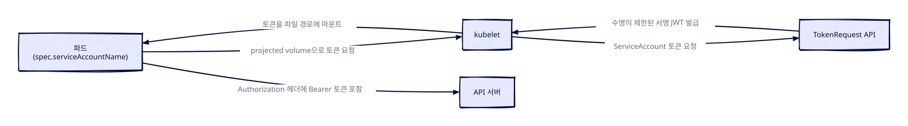

> 🤖 이 글은 공식문서를 근거로 **AI가 자동 생성**한 학습 노트입니다.

> 한 줄 요약: ServiceAccount는 파드와 자동화 워크로드에 클러스터 내 정체성을 부여하는 네임스페이스 범위 객체이며, RBAC로 권한을 얻고 수명이 제한된 JWT로 API 서버에 인증한다.

### 개요
쿠버네티스에서 API 서버에 인증하는 주체는 사람(사용자)과 파드에서 실행되는 프로세스로 나뉜다. 쿠버네티스는 사용자 개념을 인식하지만 User API는 존재하지 않는 반면, ServiceAccount는 실제 API 객체로 존재한다. ServiceAccount는 파드, 시스템 컴포넌트, 클러스터 내외부 엔티티가 특정 정체성을 가지고 API 서버에 인증하거나 identity 기반 보안 정책을 구현할 수 있게 해주는 비인간 계정이다.

### ServiceAccount의 정체성과 속성
ServiceAccount는 API 서버에 ServiceAccount 객체로 존재하며 세 가지 속성을 가진다. 첫째, 네임스페이스에 묶인다. 각 네임스페이스는 생성 시점에 `default` ServiceAccount를 가진다. 둘째, 가볍다. 클러스터 안에 존재하고 Kubernetes API로 정의되므로 특정 작업을 위해 빠르게 만들 수 있다. 셋째, 이식 가능하다. 복잡한 컨테이너 워크로드의 구성 번들에 시스템 컴포넌트용 ServiceAccount 정의를 포함할 수 있기 때문이다.

ServiceAccount는 사람을 나타내는 사용자 계정과 근본적으로 다르다. 기본적으로 사용자 계정은 API 서버에 존재하지 않으며, API 서버는 사용자 신원을 불투명한 데이터로 취급한다. 일부 배포판은 사용자 계정을 표현하는 커스텀 확장 API를 추가할 수 있다.

| 구분 | ServiceAccount | User 또는 group |
|---|---|---|
| 위치 | Kubernetes API(ServiceAccount 객체) | 외부 |
| 접근 제어 | Kubernetes RBAC 또는 다른 인가 메커니즘 | Kubernetes RBAC 또는 다른 IAM 메커니즘 |
| 의도된 용도 | 워크로드, 자동화 | 사람 |

ServiceAccount를 사용하는 대표적인 시나리오는 다음과 같다. 파드가 API 서버와 통신해야 하는 경우(Secret의 읽기 전용 접근, `kube-node-lease` 네임스페이스의 Lease 객체를 읽고 목록을 조회하는 크로스 네임스페이스 접근 등), 파드가 외부 서비스와 통신해야 하는 경우, `imagePullSecret`으로 프라이빗 이미지 레지스트리에 인증하는 경우, CI/CD 파이프라인처럼 외부 서비스가 API 서버와 통신해야 하는 경우, 그리고 파드의 ServiceAccount 신원으로 파드를 서로 다른 컨텍스트로 묶는 서드파티 보안 소프트웨어를 사용하는 경우다.

### ServiceAccount의 기본 동작과 권한 부여
클러스터를 생성하면 컨트롤 플레인이 모든 네임스페이스에 `default` ServiceAccount를 자동으로 만든다. RBAC가 활성화된 경우 이 `default` 서비스어카운트는 모든 인증된 주체에게 부여되는 기본 API discovery 권한 외에는 아무 권한도 없다. `default` 객체를 삭제하면 컨트롤 플레인이 새 객체로 교체한다.

Pod를 생성할 때 `serviceAccountName`을 지정하지 않으면 해당 네임스페이스의 `default` ServiceAccount가 자동으로 할당된다. `serviceAccountName` 필드는 Pod 생성 시점이나 새 Pod 템플릿에서만 설정할 수 있고, 이미 존재하는 Pod의 필드는 변경할 수 없다. kubelet이 ServiceAccount의 API 자격 증명을 자동 마운트하지 않게 하려면 ServiceAccount나 Pod에 `automountServiceAccountToken: false`를 설정하면 된다. 둘 다 지정된 경우 Pod spec이 우선한다.

권한 부여는 RBAC로 한다. 접근 권한을 가진 Role을 만들고 RoleBinding으로 ServiceAccount에 바인딩하면 최소 권한 원칙에 따라 필요한 권한만 부여할 수 있다. 크로스 네임스페이스 접근도 가능하다. 예를 들어 `dev` 네임스페이스의 ServiceAccount와 Pod가 `maintenance` 네임스페이스의 Job을 조회하게 하려면 Job 목록 조회 권한을 가진 Role을 만들고, `maintenance` 네임스페이스에 RoleBinding을 생성해 그 Role을 ServiceAccount에 바인딩하면 된다. ServiceAccount에 `imagePullSecrets`를 추가하면 해당 ServiceAccount를 사용하는 새 Pod의 `spec.imagePullSecrets` 필드가 자동으로 설정된다.


<figure class="ai-scene"><figcaption>RoleBinding은 어디에 만들어야 허용될까? · 설명용 시각화</figcaption><iframe class="ai-scene-frame" src="/assets/generated/designs/2026-11-14-쿠버네티스-serviceaccount-이해하기-파드의-정체성과-토큰-인증-630b50949720a149-1.html" title="RoleBinding은 어디에 만들어야 허용될까?" sandbox="allow-scripts" referrerpolicy="no-referrer" loading="lazy" height="560"></iframe>
dev·maintenance는 문서의 예시를 따른 설명용 이름이다. Role이 jobs 목록 권한을 가져도 RoleBinding이 대상 maintenance 네임스페이스에 있어야 dev Pod가 Job을 조회할 수 있다.
</figure>


### 토큰 인증 메커니즘
ServiceAccount는 서명된 JWT(JSON Web Token)로 API 서버와 신뢰 관계가 있는 다른 시스템에 인증한다. ServiceAccount로 동작하는 클라이언트는 HTTP 요청에 `Authorization: Bearer <token>` 헤더를 포함하고, API 서버는 토큰 서명, 만료 여부, 토큰 클레임의 객체 참조가 현재 유효한지, 토큰이 현재 유효한지, audience 클레임을 검증한다.

TokenRequest API가 발급한 토큰은 bound token이다. 이 바인딩은 해당 ServiceAccount로 동작하는 Pod 같은 클라이언트의 수명과 연결된다. API 서버는 토큰을 사용하는 특정 객체 참조가 여전히 존재하는지 객체의 unique ID로 대조한다. 레거시 방식으로 Secret에 마운트된 토큰은 Secret과 대조한다.

자체 서비스에서 ServiceAccount 자격 증명을 검증해야 한다면 TokenReview API를 권장한다. 이 방식은 Secret, ServiceAccount, Pod, Node 같은 API 객체에 바인딩된 토큰이 해당 객체 삭제 시 즉시 무효화된다. 예를 들어 projected ServiceAccount 토큰이 들어 있던 Pod를 삭제하면 클러스터가 그 토큰을 즉시 무효화하고 TokenReview가 바로 실패한다. OIDC 검증을 쓰면 클라이언트는 토큰이 만료 시각에 도달할 때까지 토큰을 유효한 것으로 계속 취급한다.

### 토큰 발급 방식과 수명 관리
v1.22부터 Kubernetes는 TokenRequest API로 단기 토큰을 받아 projected volume으로 Pod에 마운트한다. v1.22 이전에는 장수명 정적 토큰을 Secret으로 제공했다. 자격 증명을 수동으로 가져오는 방법은 세 가지다.

TokenRequest API는 권장 방식이다. 애플리케이션 코드에서 단기 토큰을 요청하며, 토큰은 자동으로 만료되고 만료 시 회전할 수 있다. 쿠버네티스를 모르는 레거시 애플리케이션이라면 같은 Pod 안의 사이드카 컨테이너가 토큰을 가져와 애플리케이션에 제공할 수 있다. TokenRequest의 `audience` 필드는 토큰의 의도된 수신자를 나타내며 기본값은 kube apiserver의 audience이고, `expirationSeconds`는 토큰 유효 기간을 나타낸다.

Token Volume Projection도 권장 방식이다. v1.20 이후에서 Pod spec으로 kubelet에 `ServiceAccountToken` 타입의 projected volume 추가를 지시한다. audience와 유효 기간을 지정할 수 있으며, 이는 기본 ServiceAccount 토큰에서는 설정할 수 없는 속성이다. 토큰은 자동으로 만료되고 kubelet이 만료 전에 회전한다. kubelet은 토큰이 전체 TTL의 80%를 넘기거나 24시간보다 오래되면 사전에 회전을 요청한다. 애플리케이션은 회전 시 토큰을 다시 로드할 책임이 있으며, 실제 만료 시각을 추적하지 않고 5분마다 로드하는 방식으로 충분한 경우가 많다.

Service Account Token Secrets는 비권장 방식이다. 이 토큰은 만료되지도 회전하지도 않는다. v1.24 이전에는 각 ServiceAccount에 영구 토큰이 자동 생성됐는데, `LegacyServiceAccountTokenNoAutoGeneration` 기능 게이트가 v1.24부터 v1.26까지 기본 활성화되어 자동 생성을 막았고 v1.27에서 GA로 승격되며 게이트 자체가 제거됐다. 무기한 토큰을 수동으로 만들 수는 있지만 보안 영향을 고려해야 한다.

Pod가 삭제되면 API 자격 증명은 finalizer가 있어도 자동으로 취소된다. 구체적으로 Pod의 `.metadata.deletionTimestamp` 이후 60초가 지나면 자격 증명이 취소된다. `kubectl create token` 명령으로 ServiceAccount의 시간 제한 토큰을 받을 수 있고 `--duration`으로 기간을 요청할 수 있다. 이 기능은 v1.33부터 Stable이며, v1.31 이상 kubectl에서는 `--bound-object-kind`, `--bound-object-name`, `--bound-object-uid`를 지정해 Node에 직접 바인딩된 토큰도 생성할 수 있다. 이 토큰은 만료되거나 연결된 Node나 ServiceAccount가 삭제될 때까지 유효하다. `ServiceAccountTokenNodeBinding` 기능 게이트는 잠겨 있어 비활성화할 수 없다.

projected volume 토큰의 JWT 페이로드에는 `aud`, `exp`, `iat`, `iss`, `jti`, `nbf`, `sub` 클레임과 함께 `kubernetes.io` 네임스페이스 아래 `namespace`, `node.name`, `node.uid`, `pod.name`, `pod.uid`, `serviceaccount.name`, `serviceaccount.uid`, `warnafter` 같은 클레임이 포함된다. `sub`는 `system:serviceaccount:<namespace>:<name>` 형식이다. 이 페이로드가 토큰이 특정 Pod와 ServiceAccount에 바인딩되어 있음을 보여준다.

### 보안 고려 사항과 주의점
장수명 bearer 토큰은 한번 유출되면 오용될 수 있으므로 보안 위험이다. 클러스터 외부 애플리케이션 인증에는 잘 보호된 개인 키와 인증서, 커스텀 인증 웹훅, 또는 TokenRequest로 얻은 단기 토큰을 권장한다.

v1.33부터 Beta로 기본 활성화된 `ServiceAccountNodeAudienceRestriction` 기능 게이트가 켜지면 `NodeRestriction` admission 플러그인이 kubelet이 TokenRequest API로 요청할 수 있는 audience을 제한한다. 기본적으로 kubelet은 해당 노드의 Pod가 projected service account token volume이나 CSI 드라이버 토큰 요청을 통해 이미 참조하는 audience에 대해서만 토큰을 요청할 수 있다. 관리자는 `request-serviceaccounts-token-audience` verb의 RBAC 규칙으로 kubelet에 추가 audience 접근을 허용할 수 있다. 이 제한은 kubelet(노드 신원)에만 적용되며 TokenRequest API의 다른 호출자에는 영향을 주지 않는다.

v1.32부터 `kubernetes.io/enforce-mountable-secrets` 어노테이션은 deprecated다. 이 어노테이션은 ServiceAccount의 Secret이 지정된 유형의 리소스에만 마운트되도록 제한했지만, 이제는 별도 네임스페이스로 마운트된 Secret 접근을 격리하는 것이 권장된다.

토큰 프로젝션을 활성화하면 service account issuer discovery 기능(v1.21부터 Stable)도 사용할 수 있다. 이 기능은 클라이언트가 identity provider로 연합해 외부 시스템이 relying party로 동작할 수 있게 한다. issuer URL은 OIDC Discovery Spec을 따라야 하며 https 스킴을 사용하고 `{service-account-issuer}/.well-known/openid-configuration`에서 OpenID provider 구성을 제공해야 한다.

kube-apiserver의 관련 플래그는 다음과 같다. `--service-account-issuer`는 토큰 발급자 식별자를 정의하며 여러 번 지정할 수 있다. 여러 번 지정하면 첫 번째가 토큰 생성에 사용되고 모두 허용되는 발급자로 사용된다. `--service-account-key-file`은 토큰 검증용 PEM 인코딩 X.509 키 파일을 지정한다. `--service-account-signing-key-file`은 토큰 서명에 사용할 현재 개인 키를 지정한다. `--api-audiences`는 ServiceAccount 토큰의 audience를 정의하며, 지정하지 않으면 issuer URL만 포함된 단일 audience 목록이 기본값이 된다.

### 정리
ServiceAccount는 파드와 자동화 워크로드가 API 서버와 그 외 신뢰 관계가 있는 시스템에 대해 가지는 정체성이다. 네임스페이스에 속하고 RBAC로 최소 권한을 부여받으며, 서명된 JWT를 `Authorization` 헤더에 실어 API 서버에 인증한다. 현대적인 사용 방식은 TokenRequest API가 발급하는 수명 제한 토큰을 projected volume으로 마운트하는 것이며, 이 토큰은 Pod 삭제 시 무효화되고 kubelet이 만료 전에 회전한다. 장수명 정적 토큰은 유출 시 오용 위험이 크므로 피하고, 자체 검증이 필요하면 TokenReview API를 사용하는 것이 안전하다.

---
> 🤖 작성 모델: `deepseek/deepseek-v4-flash-0731` (OpenRouter)
> 
> 참고한 공식문서:
> - [https://kubernetes.io/docs/concepts/security/service-accounts/](https://kubernetes.io/docs/concepts/security/service-accounts/)
> - [https://kubernetes.io/docs/reference/kubernetes-api/authentication-resources/token-request-v1/](https://kubernetes.io/docs/reference/kubernetes-api/authentication-resources/token-request-v1/)
> - [https://kubernetes.io/docs/tasks/configure-pod-container/configure-service-account/](https://kubernetes.io/docs/tasks/configure-pod-container/configure-service-account/)
