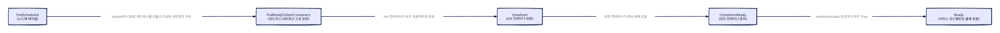

> 🤖 이 글은 공식문서를 근거로 **AI가 자동 생성**한 학습 노트입니다.

> 한 줄 요약: 파드의 `phase`가 담지 못하는 세부 상태를 보완하기 위해 kubelet과 컨트롤러가 관리하는 내장 `PodCondition`의 종류, 전이 순서, 그리고 readiness gate를 통한 확장 방식을 정리한다.

### 개요

쿠버네티스에서 많은 오브젝트는 `conditions`를 가진다. 조건(condition)은 오브젝트가 나타내는 실제 상태의 특정 측면을 가리키는 표식이다. 파드의 `phase`는 파드가 라이프사이클의 어느 지점에 있는지에 대한 고수준 요약을 제공하지만, 단일 값으로 전체 그림을 담을 수는 없다. 예를 들어 파드가 `Running` 단계에 있더라도 아직 트래픽을 서빙할 준비가 되지 않았을 수 있다.

파드 조건은 이러한 `phase`를 보완한다. 스케줄링되었는지, 컨테이너가 준비되었는지, 리사이즈가 진행 중인지, taint 때문에 곧 중단(disruption)될 예정인지 등 여러 측면을 독립적으로 추적한다. 그래서 컨트롤러와 트러블슈팅 담당자가 파드의 건강 상태를 이해하는 중요한 수단이 된다.

### PodCondition의 구조

파드의 `status`는 `PodCondition` 배열을 포함하며, 각 요소는 파드가 특정 체크포인트를 통과했는지를 나타낸다. 각 `PodCondition` 요소는 다음 필드로 구성된다.

| 필드 | 설명 |
| --- | --- |
| `type` | 파드 조건의 이름 |
| `status` | 조건이 적용되는지 여부. `True`, `False`, `Unknown` 중 하나 |
| `lastProbeTime` | 조건이 마지막으로 프로브된 시각 |
| `lastTransitionTime` | 조건의 status가 마지막으로 전이된 시각 |
| `reason` | 마지막 전이 이유를 나타내는 기계 판독용 UpperCamelCase 텍스트 |
| `message` | 마지막 status 전이에 대한 세부 정보를 담은 사람이 읽을 수 있는 메시지 |
| `observedGeneration` | 조건이 기록된 시점의 `.metadata.generation` |

실행 중인 파드의 `status.conditions`는 `kubectl get pod <pod-name> -o yaml`로 확인할 수 있다. 예시에서는 다섯 가지 라이프사이클 조건이 모두 `True`이고 각각 `lastTransitionTime`과 `observedGeneration: 1`을 가진다.

### 라이프사이클 조건

kubelet은 파드가 라이프사이클을 진행하면서 다음 조건을 대략 이 순서로 설정한다.



각 조건의 의미는 다음과 같다.

- `PodScheduled`: 파드가 노드에 스케줄링되었음을 나타낸다.
- `PodReadyToStartContainers`: 파드 샌드박스가 성공적으로 생성되고 네트워킹이 구성되었음을 나타낸다. 샌드박스와 네트워크는 컨테이너 런타임과 CNI 플러그인이 설정한다.
- `Initialized`: 모든 init 컨테이너가 성공적으로 완료되었음을 나타낸다. init 컨테이너가 없는 파드라면 샌드박스 생성 전에 `True`로 설정된다.
- `ContainersReady`: 파드의 모든 컨테이너가 준비되었음을 나타낸다. 컨테이너의 준비 상태는 readiness probe가 구성된 경우 그 probe가 결정한다.
- `Ready`: 파드가 요청을 서빙할 수 있고 모든 매칭 Service의 로드밸런싱 풀에 추가되어야 함을 나타낸다. `Ready`가 아닌 파드는 Service 엔드포인트에서 제거된다.

`Ready` 조건은 `ContainersReady` 이상의 것을 요구한다. 파드가 `readinessGates`를 지정하면 그 사용자 정의 조건들도 모두 `True`여야 파드가 `Ready`가 된다.

#### PodReadyToStartContainers의 동작

`PodReadyToStartContainers` 조건은 v1.28에서 처음 등장했고 v1.37부터 stable이다. 초기 개발 단계에서는 `PodHasNetwork`라는 이름이었다. 이제 feature gate가 잠겨 있어서 `PodReadyToStartContainersCondition` 게이트에 값을 명시해도 쿠버네티스는 무시하며 오류도 보고하지 않는다.

파드가 노드에 스케줄링된 뒤에는 kubelet의 승인(admission)과 필수 스토리지 볼륨 마운트가 필요하다. 이 단계들이 끝나면 kubelet은 CRI를 통해 컨테이너 런타임과 협력해 런타임 샌드박스를 만들고 파드의 네트워킹을 구성한다. kubelet은 다음 시나리오에서 이 조건을 `False`로 설정한다.

- 파드 라이프사이클 초기에 kubelet이 아직 샌드박스 설정을 시작하지 않은 경우
- 파드가 축출(eviction)되지 않은 채 노드가 재부팅되어 샌드박스가 파괴된 경우
- 가상 머신으로 격리하는 컨테이너 런타임에서 샌드박스 VM이 재부팅되어 새 샌드박스와 새 컨테이너 네트워크 구성이 필요한 경우

런타임 플러그인이 샌드박스 생성과 네트워크 구성을 성공적으로 마치면 kubelet은 이 조건을 `True`로 설정한다. 그 후에야 kubelet은 컨테이너 이미지를 pull하고 컨테이너를 생성할 수 있다.

init 컨테이너가 있는 파드에서는 샌드박스 생성과 네트워크 구성이 성공적으로 끝난 뒤 init 컨테이너가 완료되어야 `Initialized`가 `True`가 된다. init 컨테이너가 없는 파드에서는 샌드박스 생성과 네트워크 구성이 시작되기 전에 `Initialized`가 `True`로 설정된다.

### 기타 조건

라이프사이클 진행의 일부가 아니라 특정 작업이나 이벤트에 응답하여 설정되는 조건이 두 종류 있다.

#### DisruptionTarget

`DisruptionTarget` 조건은 파드가 disruption 때문에 곧 삭제될 예정임을 나타내기 위해 추가된다. 조건의 `reason` 필드는 파드 종료 이유를 다음 중 하나로 추가로 알려준다.

| reason | 의미 |
| --- | --- |
| `PreemptionByScheduler` | 더 높은 우선순위 파드를 수용하기 위해 스케줄러가 파드를 선점(preempt) 예정 |
| `DeletionByTaintManager` | 파드가 허용하지 않는 `NoExecute` taint 때문에 kube-controller-manager의 노드 라이프사이클 컨트롤러에 속한 Taint Manager가 삭제 예정 |
| `EvictionByEvictionAPI` | Kubernetes API를 통한 eviction으로 표시됨 |
| `DeletionByPodGC` | 더 이상 존재하지 않는 노드에 바인딩된 파드를 Pod garbage collection이 삭제 예정 |
| `TerminationByKubelet` | 노드 압력 eviction, graceful node shutdown, 시스템 중요 파드 선점 때문에 kubelet이 파드 종료 |

파드 컨테이너 한도 초과로 인한 eviction 같은 다른 disruption 시나리오에서는 `DisruptionTarget` 조건이 붙지 않는다. 그러한 disruption은 파드 자체가 원인일 가능성이 높고 재시도해도 다시 발생할 것이기 때문이다.

또한 파드 disruption은 중단될 수 있다. 컨트롤 플레인이 같은 파드의 disruption을 다시 시도할 수도 있지만 보장되지는 않는다. 그래서 `DisruptionTarget` 조건이 추가되었더라도 파드가 실제로 삭제되지 않을 수 있으며, 이런 상황에서는 시간이 지나면 조건이 지워진다. PodGC는 파드를 정리하면서 non-terminal 단계의 파드를 failed로 표시하기도 한다. Job이나 CronJob을 사용한다면 이 disruption 조건들을 Job의 파드 실패 정책(pod failure policy)에 활용할 수 있다.

#### PodResizePending과 PodResizeInProgress

kubelet은 리사이즈 요청의 상태를 나타내기 위해 파드의 status 조건을 갱신한다.

- `PodResizePending`: kubelet이 요청을 즉시 승인할 수 없다. `message` 필드가 그 이유를 설명한다. `reason: Infeasible`은 현재 노드에서 요청된 리사이즈가 불가능함(예: 노드가 가진 것보다 많은 리소스 요청)을 뜻하고, `reason: Deferred`는 지금은 불가능하지만 나중에 가능해질 수 있음(예: 다른 파드가 제거되는 경우)을 뜻한다.
- `PodResizeInProgress`: kubelet이 리사이즈를 승인하고 리소스를 할당했지만 변경 사항이 아직 적용 중이다. 보통은 짧지만 리소스 유형과 런타임 동작에 따라 더 오래 걸릴 수 있다. 적용 중 오류는 `reason: Error`와 함께 `message` 필드에 보고된다.

요청이 `Deferred`라면 kubelet은 다른 파드가 제거되거나 축소되는 등의 시점에 리사이즈를 주기적으로 재시도한다. 참고로 실행 중인 파드를 재생성 없이 CPU·메모리 요청/한도를 조정하는 in-place Pod resize는 v1.35부터 stable이며, 컨테이너의 리소스 명세를 파드의 `/resize` 서브리소스로 갱신하는 방식으로 동작한다.

### readiness gate로 사용자 정의 조건 추가

내장 조건 외에도 파드 readiness gate를 이용해 사용자 정의 조건을 정의할 수 있다. 애플리케이션이 파드의 `.status`에 추가 피드백이나 신호를 주입하는 이 방식을 enhanced Pod readiness라고 한다.

사용 방법은 파드 `spec`의 `readinessGates`에 kubelet이 readiness 평가에 사용할 추가 조건 목록을 지정하는 것이다. 그런 다음 사용자 정의 조건을 관리하는 컨트롤러를 구현하거나 설치하면, kubelet이 파드 readiness를 결정할 때 그 조건을 추가 입력으로 사용한다. readiness gate는 파드의 `status.condition` 필드의 현재 상태로 결정되며, kubelet이 `status.conditions`에서 해당 조건을 찾지 못하면 그 조건의 status는 `False`로 기본 설정된다.

```yaml
kind: Pod
...
spec:
  readinessGates:
    - conditionType: "www.example.com/feature-1"
status:
  conditions:
    - type: Ready  # 내장 PodCondition
      status: "False"
      lastProbeTime: null
      lastTransitionTime: 2018-01-01T00:00:00Z
    - type: "www.example.com/feature-1"  # 추가 PodCondition
      status: "False"
      lastProbeTime: null
      lastTransitionTime: 2018-01-01T00:00:00Z
  containerStatuses:
    - containerID: docker://abcd...
      ready: true
```

추가하는 파드 조건의 이름은 쿠버네티스 label key 형식을 충족해야 한다. 애플리케이션과 운영자는 파드의 status 서브리소스에 `PATCH` 액션을 사용해 `status.conditions`를 설정해야 한다. `kubectl patch`에 `--subresource=status`를 쓰거나 쿠버네티스 클라이언트 라이브러리로 코드를 작성하면 된다.

사용자 정의 조건을 쓰는 파드는 다음 두 문장이 모두 성립할 때만 ready로 평가된다.

- 파드의 모든 컨테이너가 ready
- `readinessGates`에 지정된 모든 조건이 `True`

컨테이너는 ready인데 사용자 정의 조건이 하나라도 없거나 `False`라면, kubelet은 파드의 `Ready` 조건을 `status: "False"`, `reason: ReadinessGatesNotReady`로 설정한다.



<figure class="ai-scene"><figcaption>컨테이너는 ready인데 왜 파드 Ready는 False일까? · 설명용 시각화</figcaption><iframe class="ai-scene-frame" src="/assets/generated/designs/2026-11-21-쿠버네티스-내장-파드-컨디션-podcondition-의-구조와-동작-원리-54be0418ea156fa4-1.html" title="컨테이너는 ready인데 왜 파드 Ready는 False일까?" sandbox="allow-scripts" referrerpolicy="no-referrer" loading="lazy" height="560"></iframe><p class="ai-scene-summary">readiness gate 규칙: 파드는 모든 컨테이너가 ready이고 readinessGates의 모든 조건이 True일 때만 Ready로 평가된다. 예시 파드의 컨테이너는 ready이며 게이트는 www.example.com/feature-1 하나다.</p></figure>


### 정리

파드 조건은 `phase`라는 단일 요약값이 놓치는 세부 상태를 여러 축으로 독립적으로 추적하는 메커니즘이다. 라이프사이클 조건(`PodScheduled`, `PodReadyToStartContainers`, `Initialized`, `ContainersReady`, `Ready`)은 kubelet이 파드 진행에 따라 순서대로 설정하며, `DisruptionTarget`과 `PodResizePending`/`PodResizeInProgress`는 특정 이벤트나 작업에 응답하여 설정된다. readiness gate를 사용하면 사용자 정의 조건을 추가해 파드 readiness 판정을 애플리케이션의 신호로 확장할 수 있다. 각 조건의 `status`, `reason`, `message`, `observedGeneration`을 함께 보면 파드가 어떤 체크포인트를 통과했고 왜 그 상태에 머무는지 진단할 수 있다.

---
> 🤖 작성 모델: `deepseek/deepseek-v4-flash-0731` (OpenRouter)
> 
> 참고한 공식문서:
> - [https://kubernetes.io/docs/concepts/workloads/pods/pod-condition/](https://kubernetes.io/docs/concepts/workloads/pods/pod-condition/)
> - [https://kubernetes.io/docs/concepts/configuration/manage-resources-containers/](https://kubernetes.io/docs/concepts/configuration/manage-resources-containers/)
> - [https://kubernetes.io/docs/concepts/workloads/pods/init-containers/](https://kubernetes.io/docs/concepts/workloads/pods/init-containers/)
