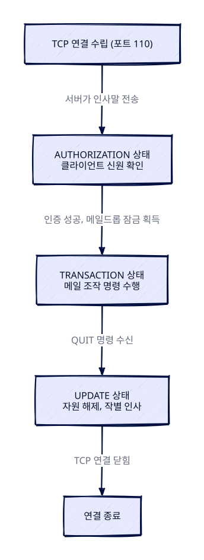

> 🤖 이 글은 공식문서를 근거로 **AI가 자동 생성**한 학습 노트입니다.

> 한 줄 요약: POP3는 자원이 부족한 작은 노드가 서버의 메일드롭에 접근해 메일을 내려받는 프로토콜로, 일반적으로 메일을 내려받은 뒤 삭제하는 단순한 모델을 전제로 한다. TCP 110 포트에서 AUTHORIZATION·TRANSACTION·UPDATE 세 상태를 순서대로 거치며 동작한다.

### 개요

POP3(Post Office Protocol - Version 3)는 워크스테이션이나 개인용 컴퓨터 같은 작은 노드가 서버 호스트에 보관된 메일드롭(maildrop)에 동적으로 접근해 메일을 수신하기 위한 프로토콜이다. 서버에서 메일을 광범위하게 조작하는 것은 이 프로토콜의 목표가 아니며, 더 정교한 조작이 필요하다면 더 복잡한 IMAP4(RFC 1730)가 대안으로 언급된다. 본문에서 "클라이언트 호스트"는 POP3 서비스를 이용하는 호스트, "서버 호스트"는 POP3 서비스를 제공하는 호스트를 뜻한다.

### 설계 배경: 자원이 부족한 노드를 위한 메일 수신

인터넷의 일부 작은 노드에서는 메시지 전송 시스템(MTS)을 유지하는 것이 현실적으로 어렵다. 예를 들어 워크스테이션은 SMTP 서버와 로컬 메일 전달 시스템을 상주시켜 계속 실행할 만한 처리 능력이나 디스크 공간이 없을 수 있고, 개인용 컴퓨터는 오랜 시간 IP 네트워크에 연결되어 있기 어려운 "연결성(connectivity)" 부족 문제를 겪을 수 있다.

이런 문제를 해결하기 위해 MTS 엔티티를 지원할 수 있는 노드가 자원이 부족한 노드에게 메일드롭 서비스를 제공한다. POP3는 워크스테이션이 서버 호스트의 메일드롭에 동적으로 접근해 서버가 보관 중인 메일을 가져오는 용도로 쓰인다.

메일을 전송 시스템에 넣는 방법은 이 문서의 범위가 아니지만, 철학에 부합하는 방식이 제시된다. 클라이언트 호스트의 사용자 에이전트(UA)는 메일을 보낼 때 릴레이 호스트와 SMTP 연결을 맺어 모든 메일을 전송한다. 이 릴레이 호스트는 POP3 서버 호스트일 수도 있고 아닐 수도 있으며, 임의의 수신자 주소로 메일을 수락할 수 있어야 한다(이 기능은 모든 SMTP 서버에 요구되는 것은 아니다).

### 기본 동작: 연결, 명령·응답 형식, 세션 상태 전이

POP3 서버는 TCP 110 포트에서 서비스를 시작한다. 클라이언트가 TCP 연결을 수립하면 서버는 인사말(greeting)을 보내고, 이후 연결이 닫히거나 중단될 때까지 클라이언트와 서버가 명령과 응답을 주고받는다.

#### 명령과 응답 형식

명령은 대소문자를 구분하지 않는 키워드와 선택적 인자로 구성되며 `CRLF` 쌍으로 끝난다. 키워드와 인자는 출력 가능한 ASCII 문자로 이루어지고, 각각 단일 `SPACE` 문자로 구분된다. 키워드는 3~4자, 각 인자는 최대 40자다.

응답은 상태 표시자(status indicator)와 키워드, 그리고 선택적 추가 정보로 구성되며 `CRLF` 쌍으로 끝난다. 응답 길이는 종료 `CRLF`를 포함해 최대 512자다. 상태 표시자는 긍정(`+OK`)과 부정(`-ERR`) 두 가지이며, 서버는 반드시 대문자로 보내야 한다.

일부 명령의 응답은 여러 줄(multi-line)로 이뤄진다. 첫 줄과 `CRLF`를 보낸 뒤 추가 줄이 각각 `CRLF` 쌍으로 끝나며 전송되고, 마지막에는 종료 옥텟(10진수 046, `.`)과 `CRLF`로 구성된 마지막 줄이 온다. 응답의 어떤 줄이 종료 옥텟으로 시작하면 그 줄 앞에 종료 옥텟을 덧붙이는 **바이트 스터핑(byte-stuffing)**을 적용한다. 따라서 다중 줄 응답은 `CRLF.CRLF` 다섯 옥텟으로 끝난다. 클라이언트는 줄이 종료 옥텟으로 시작하는지 검사해, 뒤에 `CRLF`가 아닌 옥텟이 이어지면 첫 옥텟을 제거하고, `CRLF`가 바로 이어지면 응답이 끝난 것으로 보고 `.CRLF` 줄은 응답의 일부로 취급하지 않는다.

서버는 인식할 수 없거나 구현되지 않았거나 문법적으로 잘못된 명령, 그리고 세션 상태가 맞지 않는 명령에 대해 반드시 부정 상태 표시자로 응답해야 한다. 클라이언트가 "서버가 선택적 명령을 구현하지 않은 경우"와 "명령을 처리할 의사나 능력이 없는 경우"를 구분할 수 있는 일반적인 방법은 없다.

#### 세션 상태 전이

POP3 세션은 수명 동안 여러 상태를 거친다. TCP 연결이 열리고 서버가 인사말을 보내면 세션은 **AUTHORIZATION** 상태에 들어간다. 이 상태에서 클라이언트는 서버에 자신을 식별해야 한다. 식별에 성공하면 서버는 클라이언트의 메일드롭과 관련된 자원을 획득하고 세션은 **TRANSACTION** 상태로 들어간다. 이 상태에서 클라이언트는 서버에 동작을 요청한다. 클라이언트가 `QUIT` 명령을 내리면 세션은 **UPDATE** 상태로 들어가고, 서버는 TRANSACTION 상태에서 획득한 자원을 해제하고 작별 인사를 한 뒤 TCP 연결을 닫는다.

### AUTHORIZATION 상태: 인증과 메일드롭 잠금

TCP 연결이 열리면 POP3 서버는 한 줄의 인사말을 보내는데, 이는 어떤 긍정 응답이든 될 수 있다. 예를 들어 `+OK POP3 server ready` 같은 형식이다. 이 시점부터 세션이 AUTHORIZATION 상태가 되며, 클라이언트는 서버에 자신을 식별하고 인증해야 한다.

이 문서에서 제시하는 인증 메커니즘은 `USER`/`PASS` 명령 조합과 `APOP` 명령 두 가지이며, 추가 메커니즘은 RFC 1734에 기술되어 있다. 모든 POP3 서버에 요구되는 단일 인증 메커니즘은 없지만, 서버는 반드시 최소 하나의 인증 메커니즘을 지원해야 한다.

인증 명령을 통해 클라이언트가 적절한 메일드롭에 접근할 수 있다고 판단되면, 서버는 세션이 UPDATE 상태에 들어가기 전에 메시지가 수정되거나 제거되는 것을 막기 위해 메일드롭에 **배타적 접근 잠금(exclusive-access lock)**을 획득한다. 잠금에 성공하면 서버는 긍정 상태 표시자로 응답하고, 삭제 표시된 메시지가 없는 상태로 세션이 TRANSACTION 상태에 들어간다. 잠금을 획득할 수 없거나, 접근이 거부되거나, 메일드롭을 파싱할 수 없는 등 메일드롭을 열 수 없으면 서버는 부정 상태 표시자로 응답한다(잠금을 획득했지만 부정 응답을 보내려 한다면, 명령을 거부하기 전에 잠금을 해제해야 한다). 부정 응답 후 서버는 연결을 닫을 수 있으며, 닫지 않았다면 클라이언트는 새 인증 명령으로 다시 시작하거나 `QUIT` 명령을 내릴 수 있다.

서버가 메일드롭을 연 뒤에는 각 메시지에 메시지 번호(message-number)를 할당하고 각 메시지의 크기를 옥텟 단위로 기록한다. 메일드롭의 첫 메시지는 `1`, 두 번째는 `2`처럼 번호가 매겨져 n번째 메시지는 `n`이 된다. POP3 명령과 응답에서 모든 메시지 번호와 크기는 10진수로 표현된다.

AUTHORIZATION 상태에서의 `QUIT` 명령은 인자가 없고 제약도 없으며 `+OK`로 응답한다. 예를 들어 클라이언트가 `QUIT`를 보내면 서버는 `+OK dewey POP3 server signing off`처럼 응답한다.

### TRANSACTION 상태: 메일드롭 조회 명령

TRANSACTION 상태에서는 클라이언트가 유효한 POP3 명령을 반복해서 내릴 수 있고, 각 명령마다 서버가 응답한다.

`STAT` 명령은 인자가 없으며 TRANSACTION 상태에서만 사용할 수 있다. 서버는 메일드롭에 대한 정보가 담긴 한 줄, 즉 **드롭 목록(drop listing)**을 긍정 응답으로 보낸다. 파싱을 단순화하기 위해 모든 POP3 서버는 드롭 목록에 일정한 형식을 사용해야 한다. 긍정 응답은 `+OK`, 단일 공백, 메일드롭의 메시지 수, 단일 공백, 메일드롭의 크기(옥텟) 순서로 구성된다. 크기 뒤에 무엇이 오는지는 규정하지 않으며, 최소 구현은 `CRLF` 쌍으로 줄을 끝내면 된다. 다만 이 문서는 드롭 목록에 추가 정보를 넣는 것을 강력히 권장하지 않는다. 삭제 표시된 메시지는 메시지 수와 크기 어느 쪽에도 포함되지 않는다. 예를 들어 클라이언트가 `STAT`를 보내면 서버는 `+OK 2 320`처럼 응답한다.

`LIST` 명령은 선택적으로 메시지 번호 인자를 받을 수 있는데, 인자가 있으면 삭제 표시된 메시지를 가리킬 수 없다. TRANSACTION 상태에서만 사용 가능하다. 인자가 주어지고 서버가 긍정 응답을 보내면 그 메시지에 대한 정보가 담긴 한 줄, 즉 **스캔 목록(scan listing)**이 온다. 인자가 없으면 응답은 다중 줄이 된다. 초기 `+OK` 뒤에 메일드롭의 각 메시지에 대해 정보가 담긴 줄이 하나씩 오며, 이 줄 역시 스캔 목록이라 부른다. 메일드롭에 메시지가 하나도 없으면 스캔 목록 없이 긍정 응답 뒤에 종료 옥텟과 `CRLF` 쌍으로 된 줄만 온다.

TRANSACTION 상태의 명령으로는 `STAT`, `LIST` 외에 `RETR`, `DELE`, `NOOP`, `RSET`이 정의되어 있다. 7장에서는 `TOP`, `UIDL`, `USER`, `PASS`, `APOP`을 선택적 명령으로 소개하는데, 이 중 `USER`/`PASS` 조합과 `APOP`은 AUTHORIZATION 상태의 인증 메커니즘이기도 하다.


<figure class="ai-scene"><figcaption>STAT 응답에서 삭제 표시된 메시지의 처리 · 설명용 시각화</figcaption><iframe class="ai-scene-frame" src="/assets/generated/designs/2026-11-24-pop3-post-office-protocol-version-3-동작-원리-rfc-1939-08b3bb6745647e41-1.html" title="STAT 응답에서 삭제 표시된 메시지의 처리" sandbox="allow-scripts" referrerpolicy="no-referrer" loading="lazy" height="560"></iframe>
설명용 메시지 크기(200·120 옥텟)를 사용한다. STAT는 +OK, 메시지 수, 크기(옥텟) 순서로 응답하며, 삭제 표시된 메시지는 수와 크기 어느 쪽에도 포함되지 않는다.
</figure>


### UPDATE 상태: 자원 해제와 세션 종료

클라이언트가 TRANSACTION 상태에서 `QUIT` 명령을 내리면 세션은 UPDATE 상태로 들어간다. 이 상태에서 POP3 서버는 TRANSACTION 상태 동안 획득한 자원을 해제하고 작별 인사를 보낸 뒤 TCP 연결을 닫는다.

서버는 비활동 자동 로그아웃 타이머를 둘 수 있는데, 이 타이머는 최소 10분이어야 한다. 그 시간 동안 클라이언트의 어떤 명령 수신도 타이머를 초기화한다. 타이머가 만료되면 세션은 UPDATE 상태로 들어가지 않으며, 서버는 어떤 메시지도 제거하지 않고 응답도 보내지 않은 채 TCP 연결을 닫는다. 즉, UPDATE 상태는 `QUIT` 명령을 통해서만 진입하며, 자동 로그아웃은 이 절차를 거치지 않는다.

### 정리

POP3는 SMTP 서버를 상주시킬 자원이나 지속적인 네트워크 연결이 없는 작은 노드가 서버의 메일드롭에서 메일을 내려받기 위한 프로토콜로, "내려받고 삭제"하는 단순한 모델을 전제로 한다. 세션은 TCP 110 포트 연결과 인사말로 시작해 AUTHORIZATION, TRANSACTION, UPDATE 상태를 순서대로 거치며, 인증 성공 시 메일드롭에 배타적 잠금을 걸어 UPDATE 전까지 메시지가 바뀌지 않도록 보장한다. 명령과 응답은 `+OK`/`-ERR` 상태 표시자와 `CRLF` 종료, 다중 줄 응답의 바이트 스터핑 같은 명확한 형식 규칙을 따르며, `STAT`와 `LIST` 같은 TRANSACTION 명령은 메일드롭과 개별 메시지의 개수·크기를 10진수로 보고한다. 마지막 `QUIT` 명령이 세션을 UPDATE 상태로 이끌어 TRANSACTION 상태에서 획득한 자원을 해제하고 연결을 종료하는 것이 이 프로토콜의 종착점이다.

---
> 🤖 작성 모델: `deepseek/deepseek-v4-flash-0731` (OpenRouter)
> 
> 참고한 공식문서:
> - [https://www.rfc-editor.org/rfc/rfc1939](https://www.rfc-editor.org/rfc/rfc1939)
