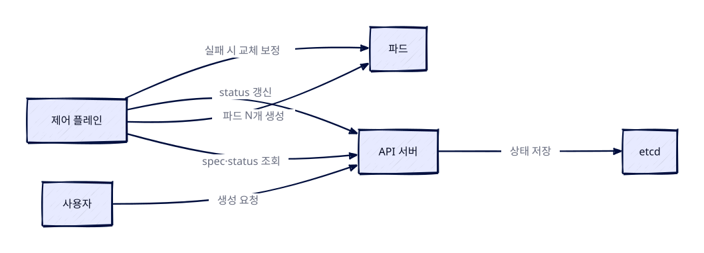

> 🤖 이 글은 공식문서를 근거로 **AI가 자동 생성**한 학습 노트입니다.

> 한 줄 요약: 쿠버네티스 오브젝트는 사용자가 선언한 desired state를 담은 '의도 기록'이다. Deployment의 `replicas: 2`처럼 spec에 적힌 선언을 제어 플레인이 status와 계속 비교해 실제 파드로 실현한다.

### 개요
쿠버네티스에서 `replicas: 2`라는 매니페스트 한 줄이 실제 파드로 이어지는 과정은 단순한 배포 명령이 아니라 지속적인 상태 관리의 결과다. 사용자는 '어떻게 실행할지'가 아니라 '어떤 상태가 되길 원하는지'를 선언하고, 시스템이 그 상태를 유지하는 책임을 진다. 이 글에서는 오브젝트 모델의 기본 개념, spec과 status의 보정 메커니즘, 그리고 선언이 API 서버를 거쳐 처리되는 과정을 순서대로 살펴본다.

### 오브젝트 모델과 spec/status 보정 메커니즘
쿠버네티스 오브젝트는 시스템 안의 영속 엔티티로, 어떤 컨테이너화된 애플리케이션이 어느 노드에서 실행 중인지, 애플리케이션이 사용할 수 있는 리소스는 무엇인지, 재시작 정책·업그레이드·장애 허용 같은 동작 정책이 무엇인지를 기술한다. 쿠버네티스 문서는 이런 오브젝트를 **record of intent**라고 부른다. 오브젝트를 생성하면 시스템은 그 오브젝트가 존재하도록 계속 작업하며, 오브젝트 생성은 곧 클러스터 워크로드의 원하는 모습을 시스템에 지시하는 행위다.

거의 모든 오브젝트는 `spec`과 `status`라는 두 중첩 필드를 가진다. `spec`은 생성 시 사용자가 설정해야 하며 리소스가 가져야 할 특성, 즉 desired state를 기술한다. `status`는 쿠버네티스 시스템과 그 구성요소가 공급하고 갱신하는 현재 상태다. 제어 플레인은 모든 오브젝트의 실제 상태를 desired state에 맞추기 위해 계속 능동적으로 관리한다.

Deployment 예시가 이 관계를 잘 보여준다. 사용자가 Deployment `spec`에 애플리케이션 3개 레플리카를 실행하라고 설정하면, 시스템은 spec을 읽고 인스턴스 3개를 시작한 뒤 status를 spec에 맞게 갱신한다. 인스턴스 하나가 실패하면 status가 변하고, 시스템은 spec과 status의 차이에 반응해 교체 인스턴스를 시작하는 방식으로 보정한다. 이처럼 spec과 status의 차이가 보정 작업의 트리거다.

이 보정 루프를 사용자, API 서버, etcd, 제어 플레인, 파드의 관계로 나타내면 다음과 같다. 파드 개수 N은 사용자가 `spec.replicas`로 선언한 값에 해당한다.





<figure class="ai-scene"><figcaption>spec과 status의 차이가 보정을 시작한다 · 설명용 시각화</figcaption><iframe class="ai-scene-frame" src="/assets/generated/designs/2026-11-26-쿠버네티스-오브젝트와-replicas-2-선언된-의도가-실제-파드가-되는-원리-a2a3ea62bb5cf250-1.html" title="spec과 status의 차이가 보정을 시작한다" sandbox="allow-scripts" referrerpolicy="no-referrer" loading="lazy" height="560"></iframe><p class="ai-scene-summary">Deployment의 spec.replicas: 2는 desired state로 고정되어 있다. 실제 파드 수가 이 선언과 같으면 보정이 필요 없고, 하나가 실패해 status가 달라지면 시스템이 교체 파드를 시작한다.</p></figure>


### 매니페스트로 desired state 선언하기
오브젝트를 생성하려면 desired state를 기술한 spec과 이름 같은 기본 정보를 API 요청 본문에 JSON으로 포함해야 한다. 보통은 매니페스트(manifest)라는 파일로 kubectl에 정보를 전달하며, 관례상 YAML을 사용한다(JSON도 가능). kubectl 같은 도구는 매니페스트를 JSON이나 다른 지원 직렬화 형식으로 변환해 HTTP로 API 요청을 보낸다.

Deployment 매니페스트는 `apiVersion`, `kind`, `metadata`, `spec` 네 가지 필수 필드를 가진다. 아래 예시에서 `spec.replicas: 2`는 템플릿과 일치하는 파드 2개를 실행하라는 선언이고, `spec.template`은 그 파드들이 가져야 할 모습(레이블, 컨테이너 이미지, 포트)을 정의한다.

```yaml
apiVersion: apps/v1
kind: Deployment
metadata:
  name: nginx-deployment
spec:
  selector:
    matchLabels:
      app: nginx
  replicas: 2 # tells deployment to run 2 pods matching the template
  template:
    metadata:
      labels:
        app: nginx
    spec:
      containers:
      - name: nginx
        image: nginx:1.14.2
        ports:
        - containerPort: 80
```

이 매니페스트를 `kubectl apply -f`에 넘기면 Deployment가 생성된다. spec의 정확한 형식은 오브젝트 종류마다 다르고 중첩 필드를 포함하므로, 각 오브젝트의 spec 형식은 Kubernetes API Reference에서 확인해야 한다.

### API 서버와 오브젝트 수명주기
쿠버네티스 API는 오브젝트의 상태를 조회하고 조작하게 해주는 HTTP API다. API 서버는 제어 플레인의 핵심이며, 사용자·클러스터 구성요소·외부 컴포넌트는 모두 API 서버를 통해 서로 통신한다. kubectl이나 kubeadm 같은 도구는 내부적으로 이 API를 사용하며, REST 호출이나 클라이언트 라이브러리로 직접 접근할 수도 있다.

오브젝트의 직렬화된 상태는 etcd에 저장된다. API는 버전별로 다른 경로(`/api/v1`, `/apis/rbac.authorization.k8s.io/v1alpha1` 등)를 제공하며, API 서버는 버전 간 변환을 투명하게 처리한다. 서로 다른 API 버전은 같은 영속 데이터의 서로 다른 표현일 뿐이다. 예를 들어 `v1beta1`로 생성한 오브젝트는 해당 버전이 폐기되기 전까지 `v1`로도 읽고 수정·삭제할 수 있다.

각 클러스터는 자신이 제공하는 API의 스펙을 두 가지 방식으로 공개한다. Discovery API는 API 이름·리소스·버전·지원 연산의 요약을 제공하고, Kubernetes OpenAPI 문서는 모든 API 엔드포인트의 전체 스키마를 제공한다. OpenAPI v3가 더 포괄적이고 정확한 뷰를 제공해 선호되며, 쿠버네티스는 v2.0과 v3.0을 함께 제공한다.

#### 서버 사이드 필드 검증
Kubernetes v1.25부터 API 서버는 오브젝트에서 인식할 수 없거나 중복된 필드를 감지하는 서버 사이드 필드 검증을 제공한다. kubectl의 `--validate` 플래그로 검증 수준을 설정하며 `ignore`, `warn`, `strict` 값을 받고, `true`(strict와 동일)와 `false`(ignore와 동일)도 허용한다. 기본값은 `--validate=true`다.

| 값 | 동작 |
|---|---|
| `strict` | 검증 실패 시 오류 발생 |
| `warn` | 검증은 수행하되 오류를 경고로 노출 |
| `ignore` | 서버 사이드 필드 검증을 수행하지 않음 |

kubectl이 필드 검증을 지원하는 API 서버에 연결할 수 없으면 클라이언트 측 검증으로 폴백하며, Kubernetes 1.27 이후 버전은 항상 필드 검증을 제공한다.

### 정리
결국 쿠버네티스의 배포는 '한 번 실행하고 끝'이 아니라 '선언한 상태를 계속 유지'하는 작업이다. 사용자가 매니페스트로 원하는 모습을 선언하면, 제어 플레인이 현재 상태를 그에 맞추기 위해 끊임없이 보정한다. 이 모든 통신은 API 서버를 중심으로 이루어지며, 오브젝트 상태는 etcd에 저장되고 API 버전 변환은 서버가 투명하게 처리한다.

---
> 🤖 작성 모델: `deepseek/deepseek-v4-flash-0731` (OpenRouter)
> 
> 참고한 공식문서:
> - [https://kubernetes.io/docs/concepts/overview/working-with-objects/](https://kubernetes.io/docs/concepts/overview/working-with-objects/)
> - [https://kubernetes.io/docs/concepts/overview/kubernetes-api/](https://kubernetes.io/docs/concepts/overview/kubernetes-api/)
> - [https://kubernetes.io/docs/reference/kubernetes-api/](https://kubernetes.io/docs/reference/kubernetes-api/)
