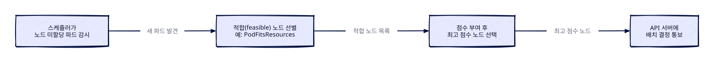

> 🤖 이 글은 공식문서를 근거로 **AI가 자동 생성**한 학습 노트입니다.

> 한 줄 요약: 쿠버네티스 스케줄러가 파드를 노드에 배치하는 필터링·스코어링·바인딩 과정과, 노드의 등록·상태 감시·장애 시 축출 메커니즘을 공식 문서를 바탕으로 정리한다.

### 개요

쿠버네티스에서 스케줄링은 파드를 노드에 매칭하여 kubelet이 실행할 수 있게 하는 과정이다. 이와 함께 프리엠션(preemption)과 축출(eviction)이 파드 배치의 핵심 메커니즘을 이룬다. 프리엠션은 낮은 우선순위의 파드를 종료해 높은 우선순위의 파드가 노드에 스케줄될 수 있게 하는 것이고, 축출은 노드에서 하나 이상의 파드를 종료하는 과정이다.

파드 중단(pod disruption)은 노드의 파드가 자발적 또는 비자발적으로 종료되는 과정으로 나뉜다. 자발적 중단은 애플리케이션 소유자나 클러스터 관리자가 의도적으로 시작하며, 비자발적 중단은 노드의 리소스 고갈이나 실수로 인한 삭제 같은 피할 수 없는 문제로 발생한다.

### 스케줄러의 역할과 배치 결정

kube-scheduler는 쿠버네티스의 기본 스케줄러로 컨트롤 플레인의 일부로 실행된다. 필요하다면 직접 스케줄링 컴포넌트를 작성해 대체할 수도 있다. 스케줄러는 새로 생성되었거나 아직 스케줄되지 않은 파드를 감시하며, 발견한 각 파드에 대해 최적의 노드를 찾는 책임을 진다.

스케줄링 결정에 고려되는 요소는 개별·집합 리소스 요구량, 하드웨어·소프트웨어·정책 제약, 어피니티와 안티-어피니티 명세, 데이터 지역성, 워크로드 간 간섭 등이다. 파드의 스케줄링 요구를 충족하는 노드를 적합(feasible) 노드라고 하며, 적합한 노드가 하나도 없으면 파드는 스케줄러가 배치할 수 있을 때까지 미스케줄 상태로 남는다.

#### 필터링과 스코어링

kube-scheduler는 노드 선택을 필터링(filtering)과 스코어링(scoring)의 2단계로 수행한다. 필터링 단계는 파드를 스케줄하기에 적합한 노드 집합을 찾는다. 예를 들어 `PodFitsResources` 필터는 후보 노드에 파드의 리소스 요청을 충족할 충분한 가용 리소스가 있는지 확인한다. 이 단계를 거치면 적합한 노드가 여러 개 남는 경우가 많으며, 목록이 비어 있으면 해당 파드는 아직 스케줄 가능하지 않다.

스코어링 단계에서는 남은 노드에 점수를 매겨 가장 적합한 배치를 고른다. 활성화된 스코어링 규칙에 따라 필터링을 통과한 각 노드에 점수가 부여되며, 최고 점수의 노드에 파드가 할당된다. 동점 노드가 여러 개면 그중 하나가 무작위로 선택된다. 스케줄러는 이 결정을 바인딩(binding) 과정을 통해 API 서버에 통보한다.

필터링과 스코어링 동작을 설정하는 방법은 두 가지가 지원된다. 스케줄링 정책(Scheduling Policies)은 필터링용 프리디케이트(Predicates)와 스코어링용 프라이어리티(Priorities)를 설정하고, 스케줄링 프로파일(Scheduling Profiles)은 `QueueSort`, `Filter`, `Score`, `Bind`, `Reserve`, `Permit` 등 다양한 스케줄링 단계를 구현하는 플러그인을 설정한다.

### 노드의 등록과 관리

노드는 가상 또는 물리 머신으로, 컨트롤 플레인이 관리하며 파드를 실행하는 데 필요한 서비스를 포함한다. 노드의 구성 요소는 kubelet, 컨테이너 런타임, kube-proxy다. 노드가 API 서버에 추가되는 방식은 두 가지다. 노드의 kubelet이 컨트롤 플레인에 자체 등록(self-register)하거나, 관리자가 Node 객체를 수동으로 추가하는 방식이다.

Node 객체가 생성되거나 kubelet이 자체 등록하면 컨트롤 플레인은 새 Node 객체가 유효한지 확인한다. `metadata.name` 필드와 일치하는 kubelet이 API 서버에 등록되었는지 확인하며, 노드가 건강하면(필요한 서비스가 모두 실행 중이면) 파드를 실행할 자격을 얻는다. 그렇지 않으면 노드가 건강해질 때까지 클러스터 활동에서 무시된다. 쿠버네티스는 유효하지 않은 Node 객체를 유지하면서 건강해지는지 계속 확인하며, 관리자나 컨트롤러가 명시적으로 Node 객체를 삭제해야 이 확인이 중단된다.

Node 객체의 이름은 유효한 DNS 서브도메인 이름이어야 하며, 두 노드는 동시에 같은 이름을 가질 수 없다. 쿠버네티스는 같은 이름의 리소스는 같은 객체라고 가정하므로, 이름을 바꾸지 않고 인스턴스가 수정되면 불일치가 발생할 수 있다. 노드를 크게 교체하거나 갱신해야 한다면 기존 Node 객체를 API 서버에서 먼저 제거한 뒤 갱신 후 다시 추가해야 한다.

#### 자체 등록과 수동 관리

kubelet의 `--register-node` 플래그가 true(기본값)이면 kubelet은 API 서버에 스스로 등록을 시도한다. 이는 대부분의 배포판이 사용하는 선호 방식이다. 자체 등록 시 kubelet은 `--kubeconfig`(API 서버 인증 자격 증명 경로), `--cloud-provider`(클라우드 제공자와의 통신 방식), `--register-node`, `--register-with-taints`(등록할 taint 목록), `--node-ip`, `--node-labels`(등록 시 추가할 라벨), `--node-status-update-frequency`(노드 상태를 API 서버에 게시하는 주기) 등의 옵션으로 시작된다.

Node 권한 부여 모드와 `NodeRestriction` admission 플러그인이 활성화되면 kubelet은 자신의 Node 리소스만 생성·수정할 수 있다. 라벨은 노드 등록 시에만 설정·수정되므로, 같은 노드 이름으로 kubelet을 재시작하며 `--node-labels`를 바꿔도 변경이 적용되지 않는다. 노드 재등록은 모든 파드를 드레인하고 제대로 재스케줄되도록 보장한다.

수동 관리에서는 `kubectl`로 Node 객체를 생성·수정하며, kubelet 플래그 `--register-node=false`로 설정한다. `--register-node` 설정과 무관하게 기존 노드에 라벨을 설정하거나 unschedulable로 표시할 수 있다. 노드 라벨은 파드의 node selector와 함께 사용해 스케줄링을 제어할 수 있으며, 예를 들어 파드를 사용 가능한 노드의 일부에서만 실행되도록 제약할 수 있다.

노드를 unschedulable로 표시하면 스케줄러가 새 파드를 배치하지 않지만 기존 파드에는 영향을 주지 않는다. 이는 노드 재부팅이나 유지보수 전 준비 단계로 유용하며, `kubectl cordon $NODENAME` 명령으로 실행한다. DaemonSet의 파드는 unschedulable 노드에서도 실행되는 것을 허용하는데, DaemonSet은 일반적으로 워크로드 애플리케이션이 드레인되어도 노드에서 실행되어야 하는 노드 로컬 서비스를 제공하기 때문이다.

### 노드 상태와 장애 대응

노드의 상태는 주소(Addresses), 조건(Conditions), 용량과 할당 가능량(Capacity and Allocatable), 정보(Info)를 포함하며 `kubectl describe node`로 확인할 수 있다. 노드가 보내는 하트비트는 클러스터가 각 노드의 가용성을 판단하고 장애 감지 시 조치를 취하는 데 도움을 준다. 하트비트는 두 형태로 나뉜다. Node의 `.status` 업데이트와 `kube-node-lease` 네임스페이스의 Lease 객체이며, 각 노드는 연결된 Lease 객체를 하나씩 가진다.

노드 컨트롤러는 노드의 다양한 측면을 관리하는 컨트롤 플레인 컴포넌트다. 첫 번째 역할은 등록 시 노드에 CIDR 블록을 할당하는 것이고, 두 번째는 노드 컨트롤러의 내부 노드 목록을 클라우드 제공자의 가용 머신 목록과 동기화하는 것이다. 클라우드 환경에서 노드가 비정상이면 노드 컨트롤러는 해당 노드의 VM이 여전히 존재하는지 클라우드 제공자에 묻고, 없으면 목록에서 노드를 삭제한다. 세 번째 역할은 노드의 건강 상태를 모니터링하는 것이다.

노드가 연결 불가능해지면 노드 컨트롤러는 Node의 `.status` 필드에서 `Ready` 조건을 `Unknown`으로 갱신한다. 노드가 계속 연결 불가능하면 연결 불가능한 노드의 모든 파드에 대해 API-initiated eviction을 트리거한다. 기본적으로 노드 컨트롤러는 노드를 `Unknown`으로 표시한 뒤 첫 축출 요청을 제출하기까지 5분을 기다린다. 노드 컨트롤러는 기본적으로 5초마다 각 노드의 상태를 확인하며, 이 주기는 `kube-controller-manager`의 `--node-monitor-period` 플래그로 설정할 수 있다.

#### 축출 속도 제한

대부분의 경우 노드 컨트롤러는 축출 속도를 초당 `--node-eviction-rate`(기본 0.1)로 제한한다. 즉 10초에 1개 노드보다 더 많은 노드에서 파드를 축출하지 않는다. 특정 가용 영역의 노드가 비정상이 되면 축출 동작이 달라진다. 노드 컨트롤러는 영역 내 비정상 노드(`Ready` 조건이 `Unknown` 또는 `False`)의 비율을 확인한다.

비정상 노드 비율이 `--unhealthy-zone-threshold`(기본 0.55) 이상이면 축출 속도가 줄어든다. 클러스터가 작으면(노드 수가 `--large-cluster-size-threshold` 기본 50 이하) 축출이 중지되고, 그 외에는 축출 속도가 초당 `--secondary-node-eviction-rate`(기본 0.01)로 감소한다. 이 정책이 가용 영역별로 구현되는 이유는 한 영역이 컨트롤 플레인과 분리되는 동안 다른 영역은 연결된 상태일 수 있기 때문이다. 클러스터가 여러 클라우드 제공자 가용 영역에 걸쳐 있지 않으면 축출 메커니즘은 영역별 비가용성을 고려하지 않는다.

노드를 가용 영역에 분산하는 핵심 이유는 한 영역 전체가 다운되면 워크로드를 건강한 영역으로 옮길 수 있기 때문이다. 따라서 영역의 모든 노드가 비정상이면 노드 컨트롤러는 정상 속도(`--node-eviction-rate`)로 축출한다. 모든 영역이 완전히 비정상인 극단적 경우에는 컨트롤 플레인과 노드 사이의 연결 문제가 있다고 가정하고 어떤 축출도 수행하지 않는다.

노드 컨트롤러는 `NoExecute` taint가 있는 노드에서 실행 중인 파드도 해당 taint를 허용하지 않으면 축출한다. 또한 노드 연결 불가능이나 not ready 같은 노드 문제에 해당하는 taint를 추가하므로, 스케줄러는 비정상 노드에 파드를 배치하지 않는다.

#### 리소스 용량 추적

Node 객체는 노드의 리소스 용량(예: 사용 가능한 메모리 양, CPU 수)을 추적한다. 자체 등록하는 노드는 등록 시 용량을 보고하며, 수동으로 추가한 노드는 추가할 때 용량 정보를 설정해야 한다. 스케줄러는 노드의 모든 파드에 충분한 리소스가 있는지 확인하는데, 노드의 컨테이너 요청 합이 노드 용량을 넘지 않는지 검사한다. 이 요청 합에는 kubelet이 관리하는 모든 컨테이너가 포함되지만, 컨테이너 런타임이 직접 시작한 컨테이너와 kubelet의 통제 밖에서 실행되는 프로세스는 제외된다.


<figure class="ai-scene"><figcaption>같은 60% 비정상인데 왜 축출이 달라질까? · 설명용 시각화</figcaption><iframe class="ai-scene-frame" src="/assets/generated/designs/2026-11-28-쿠버네티스-스케줄링과-노드-관리-파드-배치의-원리와-장애-대응-ada9f095f9bc6108-1.html" title="같은 60% 비정상인데 왜 축출이 달라질까?" sandbox="allow-scripts" referrerpolicy="no-referrer" loading="lazy" height="560"></iframe>
설명용 수치: zone-a 5노드 중 3개 비정상(60%). 문서 기본값 --unhealthy-zone-threshold 0.55, --large-cluster-size-threshold 50, --secondary-node-eviction-rate 0.01 적용.
</figure>


### 정리

쿠버네티스의 스케줄링은 스케줄러가 노드 미할당 파드를 감시하고, 필터링으로 적합 노드를 선별한 뒤 스코어링으로 최적 노드를 골라 바인딩하는 2단계 과정으로 동작한다. 노드는 kubelet의 자체 등록 또는 수동 추가로 클러스터에 합류하며, 노드 컨트롤러가 하트비트와 상태를 통해 건강을 감시하고 장애 시 축출을 수행한다. 축출은 가용 영역 단위의 비정상 비율에 따라 속도가 조절되며, 리소스 용량 추적은 스케줄러가 노드 용량을 넘지 않도록 보장한다.

---
> 🤖 작성 모델: `deepseek/deepseek-v4-flash-0731` (OpenRouter)
> 
> 참고한 공식문서:
> - [https://kubernetes.io/docs/concepts/scheduling-eviction/](https://kubernetes.io/docs/concepts/scheduling-eviction/)
> - [https://kubernetes.io/docs/concepts/scheduling-eviction/kube-scheduler/](https://kubernetes.io/docs/concepts/scheduling-eviction/kube-scheduler/)
> - [https://kubernetes.io/docs/concepts/architecture/nodes/](https://kubernetes.io/docs/concepts/architecture/nodes/)
